# Sushi Survival Race — 게임 소개 · 맵 도감

> 초밥이 되어 거대한 주방을 달리고 버티는 로블록스 파티 서바이벌. 3~4라운드 뒤 **딱 1명**만 가게 문을 박차고 탈출해요.

- 기준: 2026-11-09 `main` (기획서 GDD v0.9, 맵 26개, 스킨 41종)
- 이 문서는 **한눈에 보는 소개서**예요. 규칙·수치의 원본은 [`GDD.md`](GDD.md), 바뀐 내역은 [`CHANGELOG.md`](CHANGELOG.md), Studio 확인 방법은 [`DEV-SETUP.md`](DEV-SETUP.md).
- 캡처는 저장소의 **미리보기 렌더러**(`tools/render-map`, `tools/render-character`)로 Studio 없이 찍은 이미지예요. 근사 렌더라 실제 Studio·게임 화면과 빛·재질이 조금 달라요. 맵 캡처에는 움직이는 장애물(젓가락·벽·구멍 등)이 대부분 안 보여요(라운드가 시작돼야 움직여요).
- 수치는 모두 **기본값, 플레이테스트 후 조정**이에요.

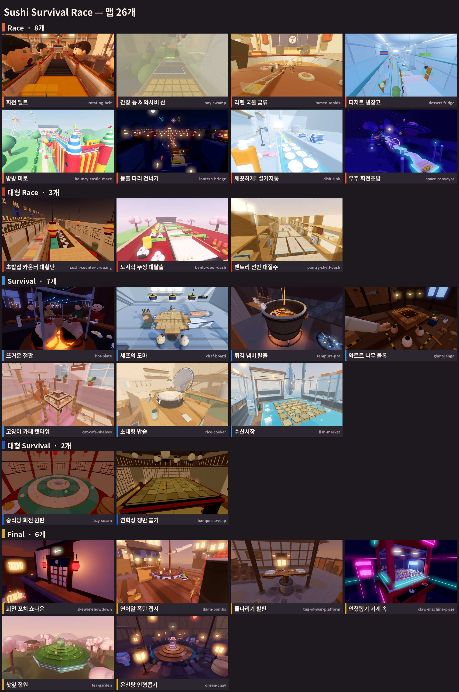

---

## 목차
1. [게임 한눈에](#1-게임-한눈에)
2. [한 판 흐름](#2-한-판-흐름)
3. [조작](#3-조작)
4. [캐릭터 · 스킨 · 뽑기](#4-캐릭터--스킨--뽑기)
5. [보상 · 상점 · 운영 기능](#5-보상--상점--운영-기능)
6. [맵 도감 (26개)](#6-맵-도감-26개)
7. [기술 메모](#7-기술-메모)

---

## 1. 게임 한눈에

| 항목 | 내용 |
|---|---|
| 장르 | 라운드제 파티 서바이벌 레이스 (Fall Guys·Stumble Guys 계열) |
| 세계관 | "작은 초밥, 거대한 주방" — 회전초밥집이 통째로 테마파크를 운영해요. 떨어지면 아래에서 입 벌린 손님에게 먹혀요 |
| 인원 | 방 최대 4 / 8 / 12 / 16 / 24 / 32 / 40명, 최소 4명이면 방장이 시작 |
| 한 판 | 3~4라운드, 약 4~5분 |
| 라운드 종류 | **Race**(결승선) · **Survival**(버티기) · **Final**(마지막 1명) |
| 플랫폼 | PC · 모바일(터치 버튼 위치 편집) · 게임패드/콘솔 |
| 언어 | 한국어 · 영어 (그 밖은 Roblox 자동 번역 → 영어) |
| 수익 | 겉모습만(스킨·연출·VIP). 능력치 판매·유료 뽑기 없음 |

**핵심 재미**
- 라운드마다 완전히 다른 맵 — 회전 벨트, 라멘 급류, 우주 레일, 고양이 카페, 인형뽑기 기계 속…
- 다이브·잡기로 남을 방해하는 몸싸움
- 떨어지면 손님에게 "먹혔다!" 탈락 연출, 우승하면 가게 문을 박차고 탈출하는 우승 연출
- 우승하면 🎫 무료 뽑기권 → 특 스킨

---

## 2. 한 판 흐름

```
로비(회전초밥집) → 방 만들기/빠른 참가 → 대기실 → 라운드 1 Race → … → 결승 Final → 우승 연출 → 로비
```

### 라운드 구성
| 시작 인원 | 라운드 | 통과 비율 |
|---|---|---|
| 4~8명 | 3라운드 | 60% → 50% → **결승 1명** |
| 9~24명 | 4라운드 | 65% → 55% → 50% → **결승 1명** |
| 25~40명 | 4라운드 | 60% → 45% → 40% → **결승 1명** (예: 40 → 24 → 11 → 4 → 1) |

- 첫 라운드는 항상 **Race**, 마지막은 항상 **Final**, 한 판에 같은 맵은 두 번 안 나와요. 4라운드면 Survival이 최소 1번.
- 라운드마다 예상 인원에 맞는 맵만 골라요. 25명 이상 판의 1라운드는 대형 Race, 대형 맵은 예상 12명 이상인 라운드에만 나와요.
- 결승에는 최소 2명이 가도록 보장해요(더 멀리·높이 간 사람부터 구제).

### 라운드 종류
| 종류 | 끝나는 조건 | 시간 | 특징 |
|---|---|---|---|
| 🏃 **Race** | 통과 정원이 결승선을 넘으면 | 90초 | **정원이 차기 전에는 떨어져도 3초 뒤 출발점에서 부활**(화면 가운데 3·2·1). 시간이 끝나면 더 멀리 간 사람부터 통과 |
| 🛡 **Survival** | 남은 인원이 정원 이하가 되면 | 75초 (60초부터 서든데스) | 시간이 끝나면 버틴 사람 **전원 통과** |
| 🏆 **Final** | 1명만 남으면 그 사람이 우승 | 90초 + **연장전** | 90초에 "⚡ 연장전!" → 20초 안에 설 곳이 모두 사라져 늦게 떨어진 사람이 우승 |

- Race 통과자는 대기석에서 다른 사람을 기다리고, 탈락하면 **관전**(다른 사람 따라보기)이나 로비로.
- 판정(결승선·탈락·순위·보상)은 전부 서버가 해요.

---

## 3. 조작

| 입력 | PC | 모바일 | 게임패드 | 설명 |
|---|---|---|---|---|
| 이동 | WASD | 조이스틱 | 왼쪽 스틱 | 속도 16 |
| 점프 | Space | 점프 버튼 | Ⓐ | 점프력 50 |
| 다이브 | Shift / E | 다이브 버튼 | Ⓧ | 앞으로 몸을 날려요. 착지 뒤 0.5초 엎드림, 쿨다운 1.5초 |
| 잡기 | 마우스 왼쪽 꾹 | 잡기 버튼 | R2 | 앞 초밥을 잡아 최대 2초 느리게(상대 ×0.5, 나 ×0.7) |

- 휴대폰은 ⚙ → "버튼 위치 편집"으로 점프·다이브·잡기 버튼을 끌어 옮기고 크기를 바꿔요.
- 게임패드는 방향키 + Ⓐ 선택 + Ⓑ 닫기로 모든 창을 다뤄요. 콘솔(TV)은 화면 가장자리 안전 여백이 들어가요.

---

## 4. 캐릭터 · 스킨 · 뽑기

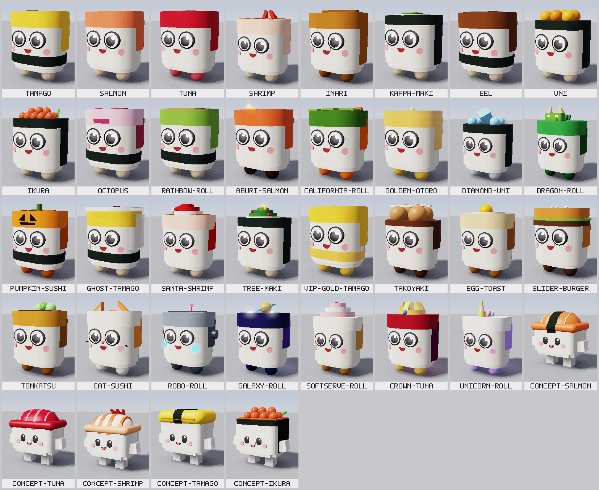

- 기본 캐릭터는 **계란초밥**. 숨쉬기·눈 깜빡임·걸음 같은 작은 움직임이 있어요.
- 스킨 **41종**: 기본 1 · 판매 26(일반·레어·에픽·전설) · 시즌 4 · VIP 전용 1 · 뽑기 전용 특 스킨 9.
- 스킨은 **겉모습만** 바꿔요. 크기·히트박스·속도는 모두 같아요.
- 특 스킨(아래 줄 "(특)")은 넓은 밥 + 작은 팔다리 몸에 표정 6가지(기본·기쁨·당황·아픔·화남·슬픔).
- 전설 **고등어 초밥 [신선]**은 팔딱거리는 생선 몸이에요(R$ 199 판매 + 뽑기 전설).

<p>
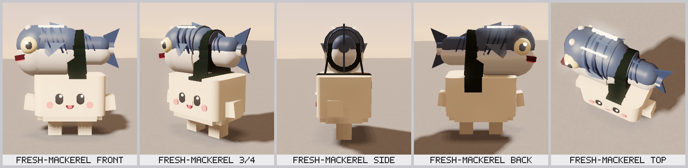
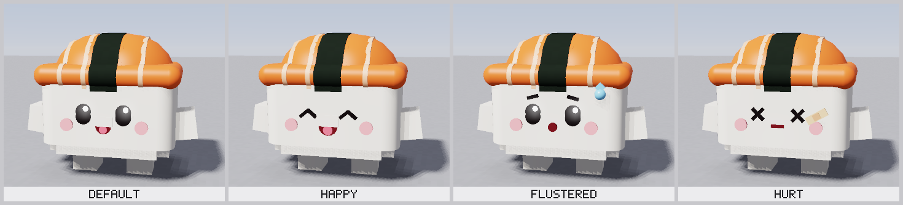
</p>

### 🎫 우승자 뽑기 (무료)
- 우승하면 뽑기권 1장(최대 99장). **돈이나 재화로 살 수 없고**, 확률을 올리는 상품·천장도 없어요.
- 꽝 없음. 등급 확률(화면에 공개): 전설 1% · 영웅 5% · 희귀 15% · 고급 30% · 일반 49%.
- 이미 가진 스킨이 나오면 밥알 코인으로 바꿔 줘요(등급별 🍚 20~300).

---

## 5. 보상 · 상점 · 운영 기능

| 기능 | 내용 |
|---|---|
| 🍚 밥알 코인 | 라운드 통과 +10, 결승 출발 +30, 우승 +100, 하루 첫 판 +50. 일반·레어 스킨을 코인으로 해금 |
| 칭호 | 1승 "탈출 초밥", 10승 "전설의 참치", 100승 "바다의 왕" |
| 🍣 탈의실 | 스킨 입어 보기·장착·구매 (달리는 중에는 잠김) |
| 💎 로벅스 스킨 | R$ 29 / 59 / 99 / 199 (에픽·전설은 로벅스만) |
| 🎁 특별 상품 | 스타터 팩, 에픽·전설 세트, 탈락·우승 연출 팩 2종 |
| 👑 VIP 패스 | 👑 이름표·[VIP] 채팅 태그·금박 계란초밥 스킨. 겉모습뿐(코인 배수 없음) |
| 🎃 시즌 이벤트 | 기간에만 이벤트 재화(🍬/⭐)를 모아 시즌 스킨 해금, 로비 시즌 장식 |
| 🎟 코드 보상 | 코드를 입력해 코인·재화 받기 (남용 방지 잠금) |
| 🏅 우승자 단상 | 로비에 최근 우승자 표시 |
| 🛠 관리자 패널 | 테스트용 스킨·연출 미리보기와 명령 (서버가 판단, 비밀번호 방식 없음) |

---

## 6. 맵 도감 (26개)

| 종류 | 수 | 맵 |
|---|---|---|
| 🏃 Race | 8 | [회전 벨트](#회전-벨트) · [간장 늪 & 와사비 산](#간장-늪--와사비-산) · [라멘 국물 급류](#라멘-국물-급류) · [디저트 냉장고](#디저트-냉장고) · [방방 미로](#방방-미로) · [등불 다리 건너기](#등불-다리-건너기) · [깨끗하게! 설거지통](#깨끗하게-설거지통) · [우주 회전초밥](#우주-회전초밥) |
| 🏃 대형 Race | 3 | [초밥집 카운터 대횡단](#초밥집-카운터-대횡단) · [도시락 뚜껑 대탈출](#도시락-뚜껑-대탈출) · [팬트리 선반 대질주](#팬트리-선반-대질주) |
| 🛡 Survival | 7 | [뜨거운 철판](#뜨거운-철판) · [셰프의 도마](#셰프의-도마) · [튀김 냄비 탈출](#튀김-냄비-탈출) · [와르르 나무 블록](#와르르-나무-블록) · [고양이 카페 캣타워](#고양이-카페-캣타워) · [초대형 밥솥](#초대형-밥솥) · [수산시장](#수산시장) |
| 🛡 대형 Survival | 2 | [중식당 회전 원판](#중식당-회전-원판) · [연회상 쟁반 쓸기](#연회상-쟁반-쓸기) |
| 🏆 Final | 6 | [회전 꼬치 쇼다운](#회전-꼬치-쇼다운) · [연어알 폭탄 접시](#연어알-폭탄-접시) · [줄다리기 발판](#줄다리기-발판) · [인형뽑기 기계 속](#인형뽑기-기계-속) · [찻잎 정원](#찻잎-정원) · [온천탕 인형뽑기](#온천탕-인형뽑기) |

- 보통 맵은 24명, **대형 맵**은 40명까지 받아요(폭 72~96, 보통 맵의 1.5~2배).
- 맵마다 조명 분위기가 달라요(라운드 소개 때 1.2초에 걸쳐 바뀜). 각 맵의 인용문은 라운드 소개 때 나오는 규칙 한 줄이에요.

---

### 🏃 Race — 정원이 결승선을 넘을 때까지 (90초, 정원 전 부활)

#### 회전 벨트
`rotating-belt` · 손님 테이블 사이를 도는 거대한 컨베이어 벨트
> 젓가락을 피해 벨트를 거슬러 결승선까지 달려요

- 벨트가 진행 **반대 방향**으로 밀어요.
- **젓가락 집기**: 빨간 원 경고 1초 → 젓가락이 내려와 3초 들었다 떨어뜨려요(시간 손해).
- 간장 종지·접시 더미로 좁아지는 병목 구간.

<p>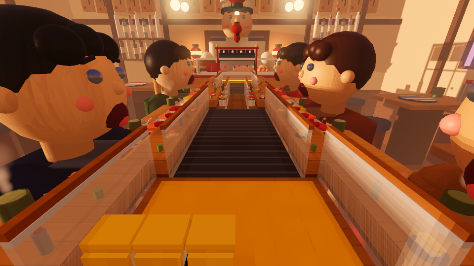 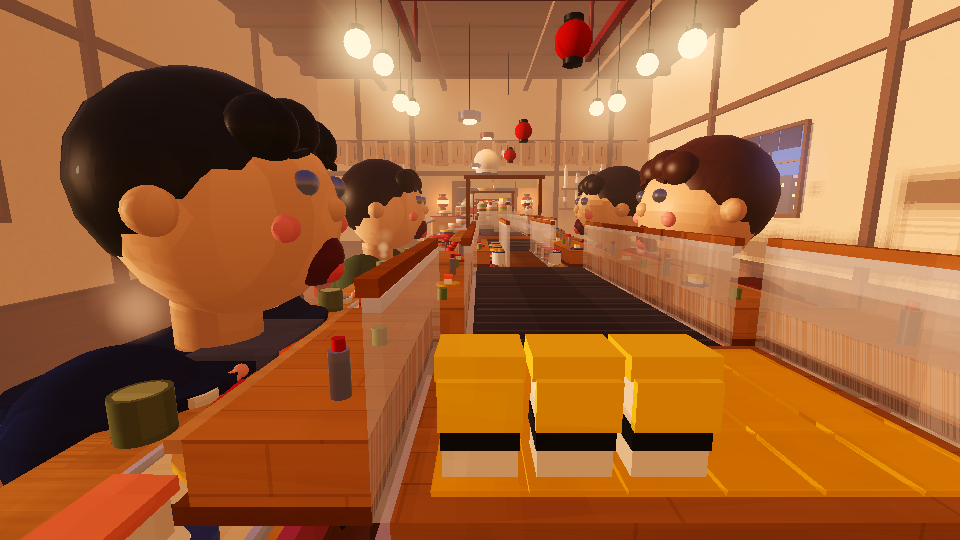</p>

#### 간장 늪 & 와사비 산
`soy-swamp`
> 간장 웅덩이는 피하고, 와사비 패드로 튀어 올라 결승선까지!

- 간장 웅덩이: 속도 50% · 점프 불가.
- 와사비 패드: 밟으면 "매워!!" 크게 튕겨요(잘 쓰면 지름길).
- 굴러오는 날치알 공에 맞으면 넘어져요.

<p>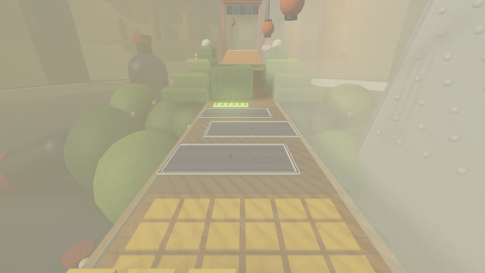 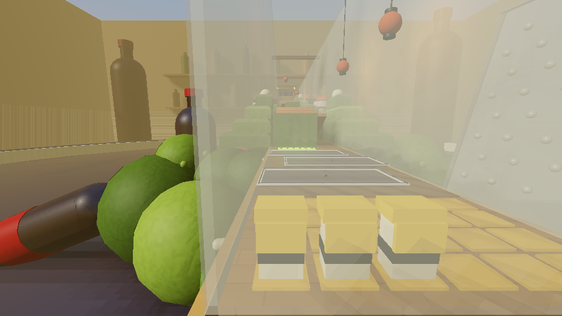</p>

#### 라멘 국물 급류
`ramen-rapids` · 약 440 studs
> 국물 급류를 타고 차슈·나루토를 밟아 건너, 결승선까지!

- **급류 미끄럼틀**: 국물이 걷기보다 빠르게 앞으로 밀고, 소용돌이 3곳이 벽 쪽으로 쏠리게 해요. 낮은 면발 줄기는 점프로.
- **토핑 건너기**: 차슈 발판이 6초 주기로 가라앉았다 떠올라요. 나루토 발판은 가라앉지 않는 쉼터.
- **회전 젓가락 막대**: 원형 발판 2개에서 막대가 반대로 돌아요. 그 뒤 젓가락 다리·렌게 계단·두 번째 급류.

<p>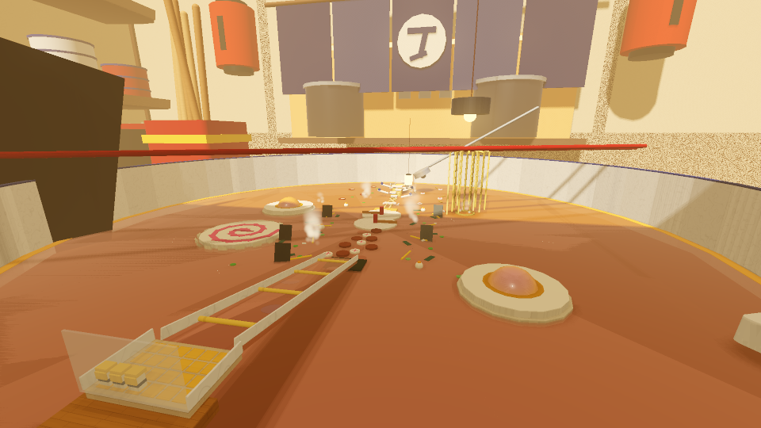 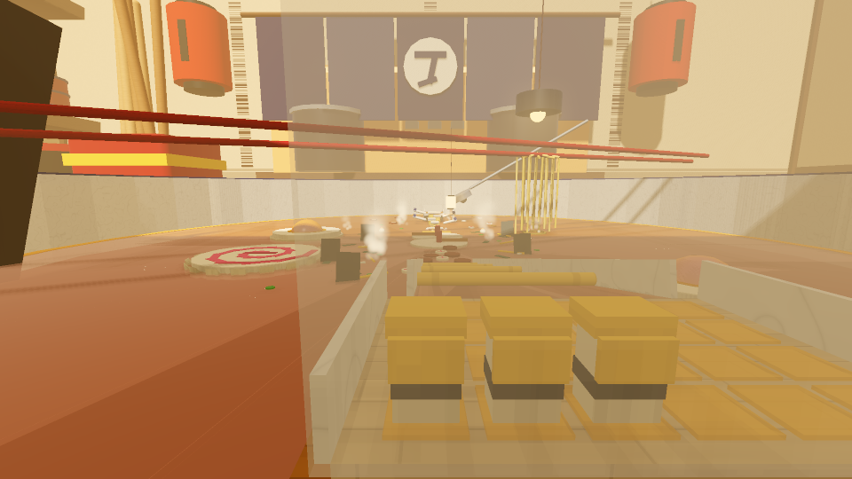</p>

#### 디저트 냉장고
`dessert-fridge` · 거대한 냉장고 안 얼음 쟁반
> 미끄러운 얼음을 건너 냉장고 문까지 달려요!

- **얼음 관성**: 손을 떼도 약 16 studs 미끄러지고 꺾기도 둥글게 돌아요.
- 구멍·얼음 큐브 → 젤리 3개로 튕겨 위 칸(또는 쿠키 계단) → 서리 경고 0.5초 뒤 2초 부는 송풍구 선반 → 냉장고 문 결승.

<p>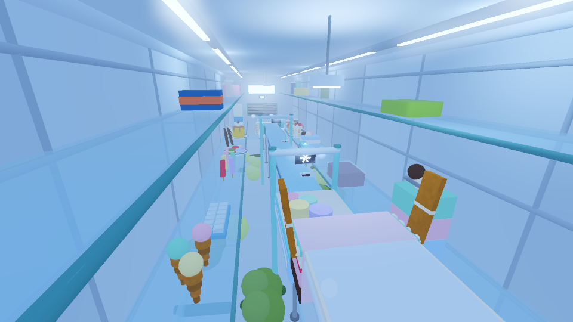 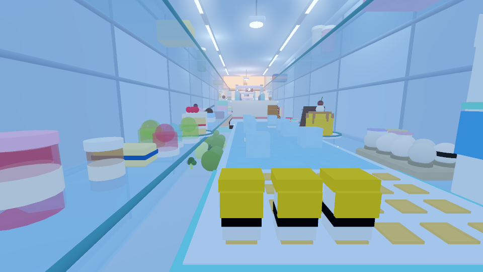</p>

#### 방방 미로
`bouncy-castle-maze` · 유원지 트램펄린
> 말랑한 바닥 위를 튕기며 미로를 빠져나가요.

- 바닥 전체가 **트램펄린** — 멈출 수 없는 Race. 튕겨도 걷던 속도는 유지돼요.
- 레인 4개를 S자로 꺾어 마지막 레인 끝 출구로만 나가요(걷는 길 약 680 studs).

<p>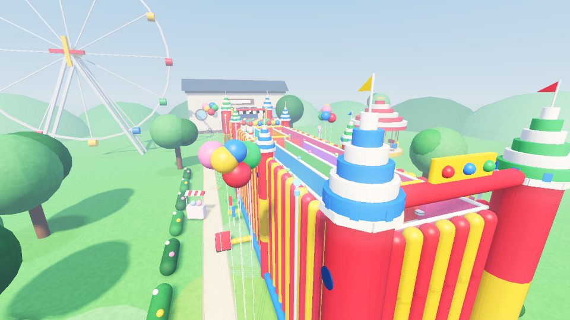 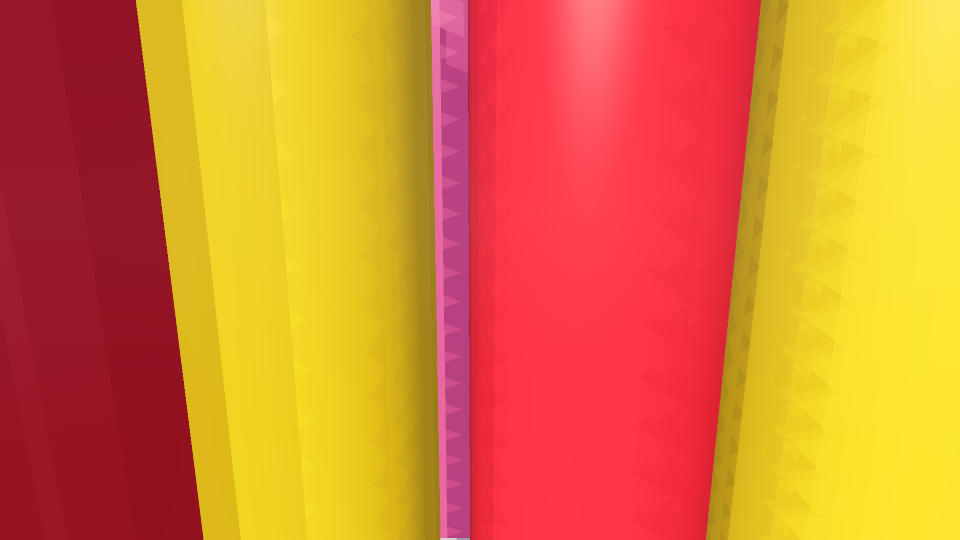</p>

#### 등불 다리 건너기
`lantern-bridge` · 밤 축제 하늘의 흔들다리
> 흔들리는 다리와 종이 등불 사이를 건너요.

- 흔들다리 4개. **위에 탄 사람이 많을수록 더 흔들리고**, 기울면 낮은 쪽으로 밀려요.
- 3번 다리(폭 4)가 가장 아슬아슬해요.

<p>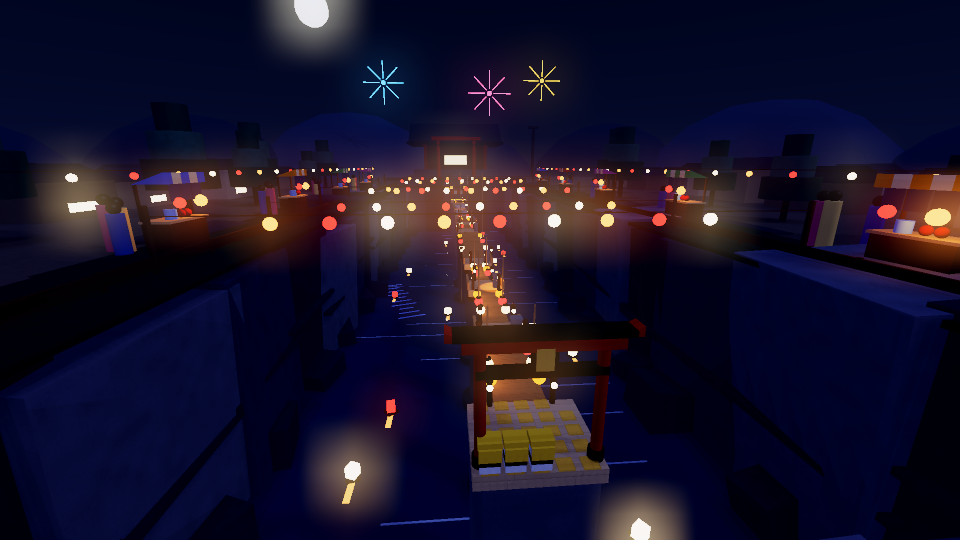 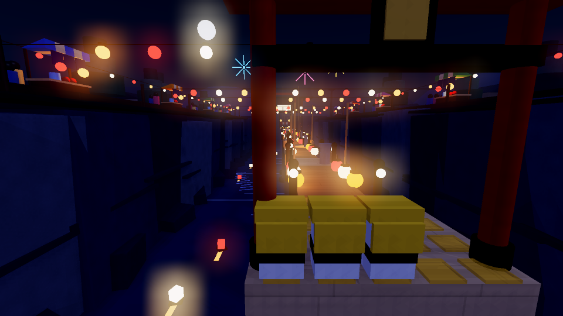</p>

#### 깨끗하게! 설거지통
`dish-sink` · 거대한 개수대
> 빙글빙글 접시와 움직이는 수세미를 피해 깨끗한 접시까지 달려요!

- **회전 접시**: 이웃끼리 반대로 돌며 옆으로 밀어요(5초 주기).
- **수세미**: 가로로 왕복하며 쓸어 가요(8초).

<p>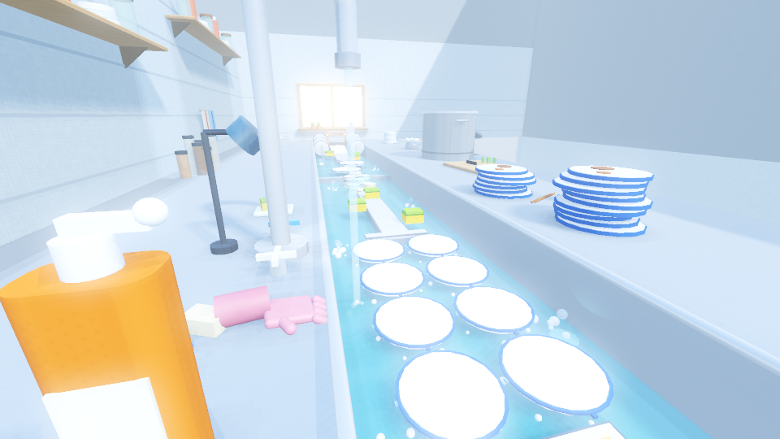 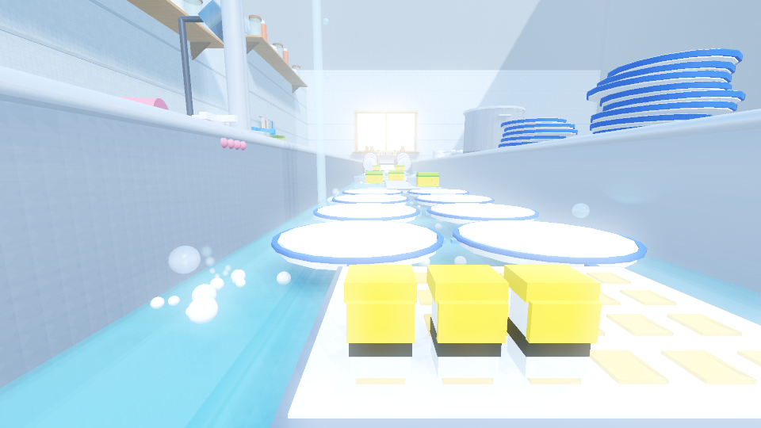</p>

#### 우주 회전초밥
`space-conveyor` · 우주 정거장 회전초밥 레일
> 방향이 바뀌는 우주 레일을 타고, 떨어지는 운석을 피해 결승까지!

- **방향 전환 레일**: 6초마다 앞/뒤로 미는 방향이 바뀌어요.
- **운석**: 10초 주기로 떨어지고 바위가 6초 남아 길을 막아요.
- 저중력 소행성 구간.

<p>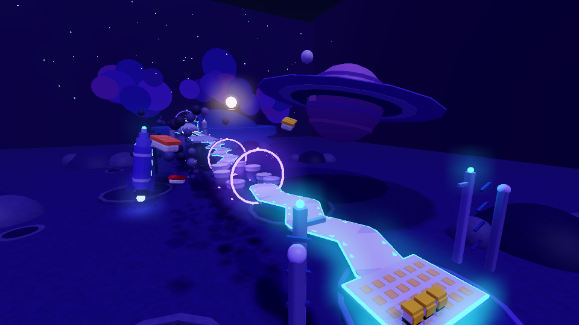 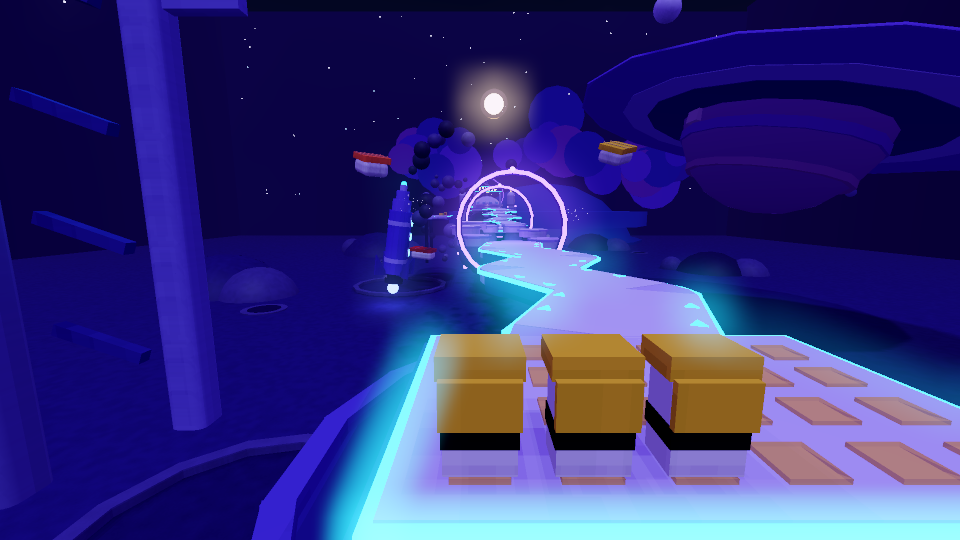</p>

---

### 🏃 대형 Race — 스폰 40 · 12~40명

#### 초밥집 카운터 대횡단
`sushi-counter-crossing` · 폭 72 · 길이 약 524
> 세 갈래 길 중 하나를 골라 젓가락을 피해 계산대까지 달려요!

- **세 갈래 길**: 왼쪽 회전 레일(5초마다 방향이 뒤바뀜, 청록=앞 / 연어=뒤) · 가운데 접시 징검다리 · 오른쪽 굴러오는 간장병.
- **젓가락 들판**: 0.9초마다 빨간 원 → 1.5초 뒤 젓가락이 쿡 찍어 날려요.
- **계산대 오르막 4줄**: 바깥 두 줄은 영수증이 뒤로 밀고(느리지만 안전), 안쪽 두 줄은 동전 더미가 굴러와요(빠르지만 위험).

<p>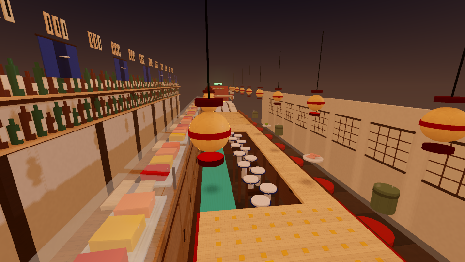 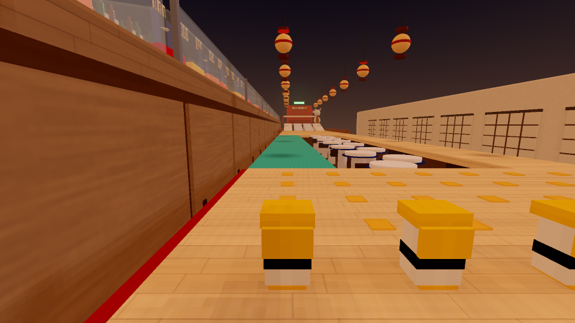</p>

#### 도시락 뚜껑 대탈출
`bento-door-dash` · 폭 80 · 길이 500
> 진짜 뚜껑 문을 찾아 부수고 도시락 끝까지 달려요! 가짜 문은 튕겨 나와요.

- **문 8개 × 5줄**: 판마다 진짜 문이 바뀌어요. 진짜 문은 부서지고, 가짜 문은 튕겨 내요 — 앞사람이 길을 열어 줘요.
- 문 줄 사이: 굴러오는 공, 간장 웅덩이(느려짐), 회전 막대(점프로 넘기), 와사비 튕김 패드.

<p>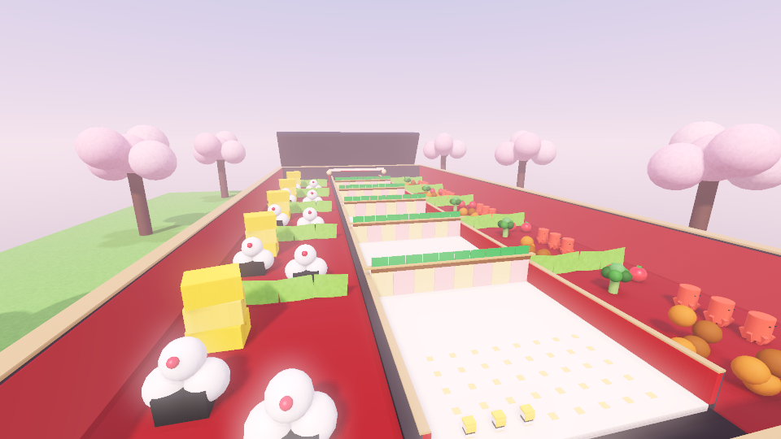 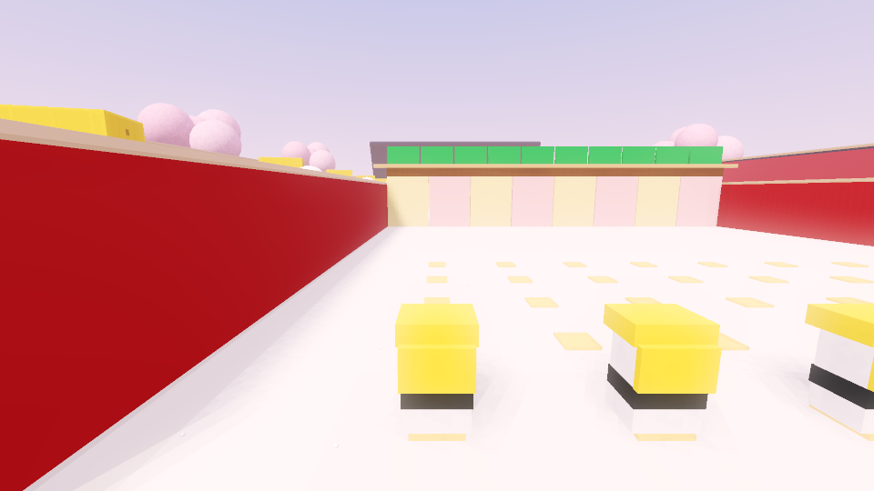</p>

#### 팬트리 선반 대질주
`pantry-shelf-dash` · 폭 96
> 옆바람과 굴러오는 통조림을 피해 선반 사이를 뛰어 큰 병뚜껑까지!

- 선반 섬 5줄 사이 틈 8을 점프로 건너요.
- **환풍기 옆바람**: 줄마다 6초 중 4초 켜지고, 켜지면 흰 줄무늬가 보여요.
- 2·4번 줄에 통조림이 굴러와요.

<p>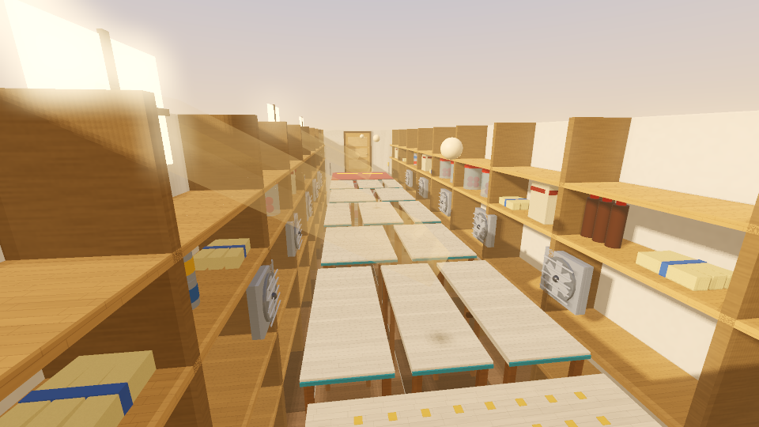 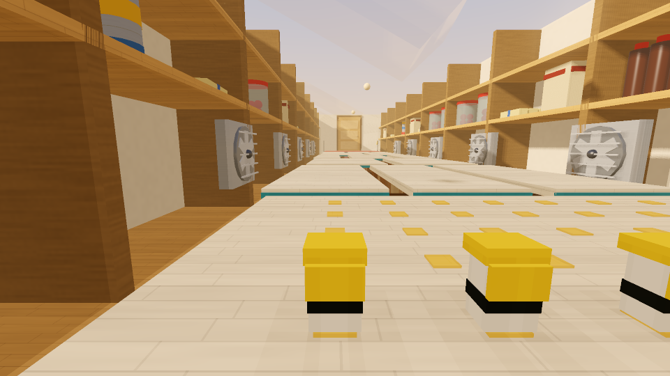</p>

---

### 🛡 Survival — 정원만 남을 때까지 버티기 (75초, 60초부터 서든데스)

#### 뜨거운 철판
`hot-plate` · 밤 철판 요리집
> 밟은 철판은 곧 사라져요. 계속 움직여서 끝까지 버티세요!

- 밟은 타일이 빨갛게 달아오르다 1.5초 뒤 사라져요(서든데스 1.2초).
- 층이 3개라 떨어져도 아래층에서 기회가 있어요.

<p>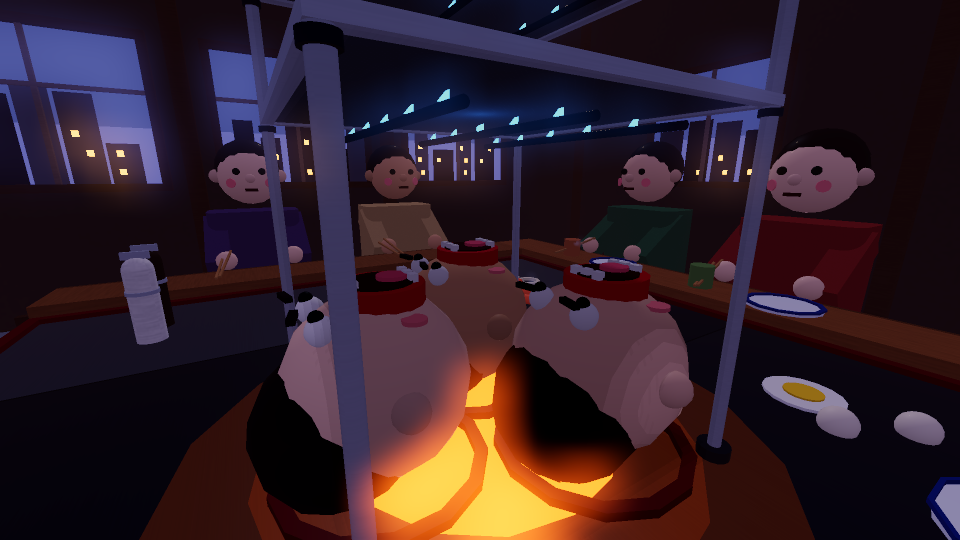 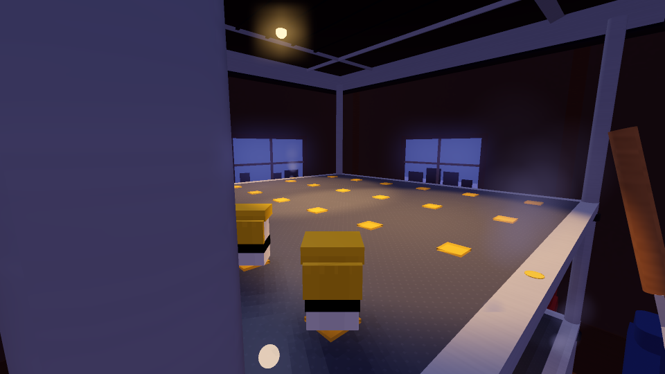</p>

#### 셰프의 도마
`chef-board` · 공중에 뜬 원형 도마(지름 72)
> 칼이 내려치는 줄을 피하고, 잘려 나가는 도마 위에서 끝까지 버티세요!

- **칼 내려치기**: 가로·세로 한 줄에 빨간 경고 줄 → 거대한 칼이 "탕!" 하고 내리쳐서 튕겨 내요. 점점 빨라져요.
- 칼이 지나간 줄 양 끝 칸이 떨어져 도마가 점점 작아져요(가운데 3×3은 끝까지 남음).
- 10초마다 도마가 8도 기울었다 돌아와요.

<p>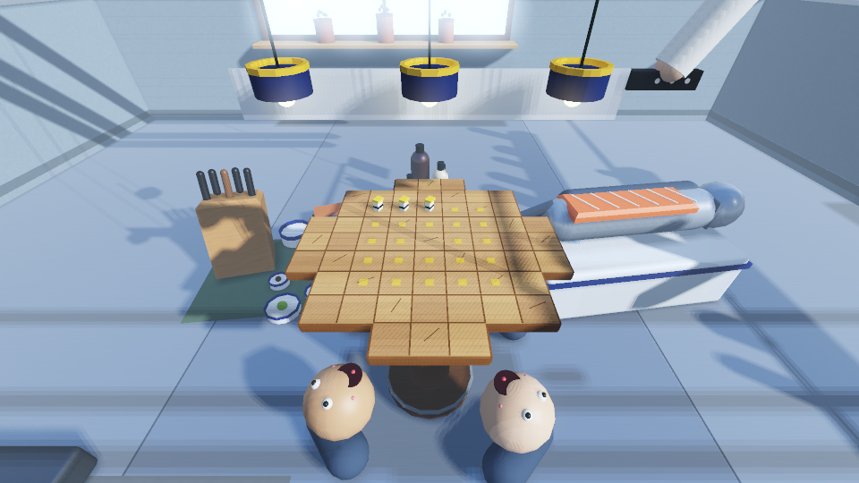 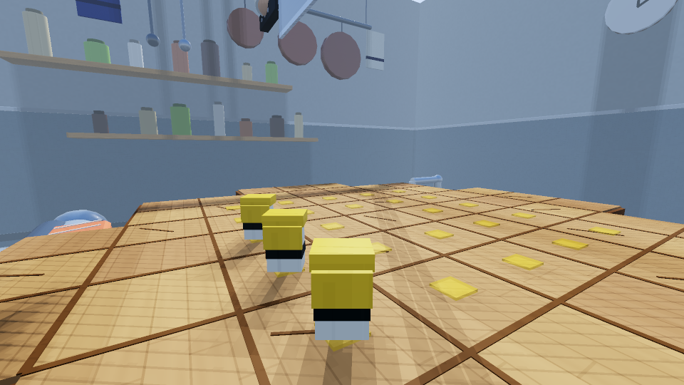</p>

#### 튀김 냄비 탈출
`tempura-pot` · 밤 주방의 튀김 냄비
> 차오르는 기름을 피해 위로! 튀는 기름도 조심!

- 6초 뒤부터 기름이 차올라요. 나선 발판을 점프로 올라가요.
- 10초부터 서 있는 발판에 주황 경고 원 → 튀는 기름이 넉백.
- 꼭대기 세 층은 좁아서 자리싸움.

<p>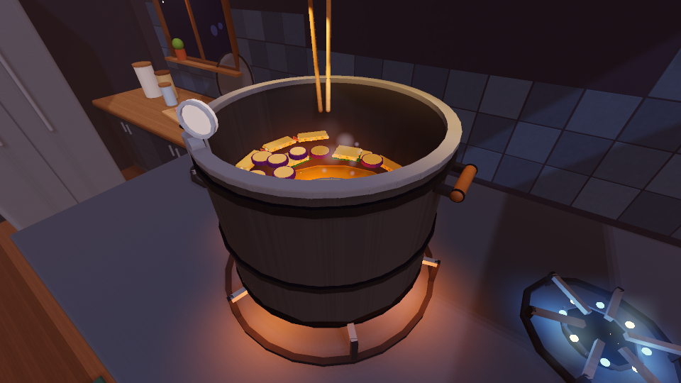 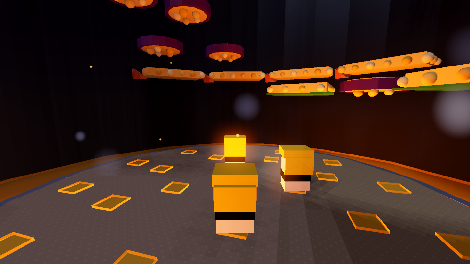</p>

#### 와르르 나무 블록
`giant-jenga` · 5×5 블록 탑
> 블록이 빠진 쪽으로 바닥이 기울어요. 떨어지지 말고 끝까지 버텨요!

- 바깥 칸이 삐걱이며 한 단씩 가라앉고, 그 주변이 구멍 쪽으로 기울어 미끄러져요.
- 가운데 3×3은 끝까지 남고, 48초부터 빨라져요.

<p>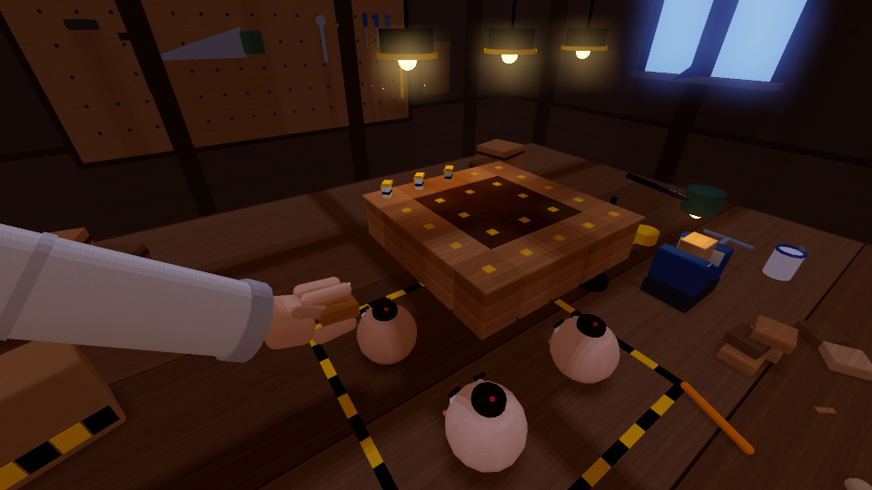 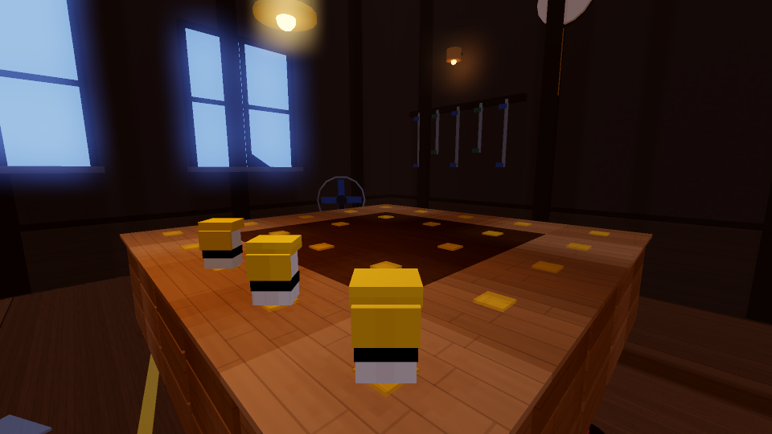</p>

#### 고양이 카페 캣타워
`cat-cafe-shelves` · 3단 좁은 선반
> 좁은 선반 사이를 옮겨 다니며 버텨요. 가장자리 밖으로 밀리면 안 돼요!

- 분홍 장난감 공이 선반을 왕복하며 밀어내요.
- 8초부터 사람이 선 선반이 주황으로 변한 뒤 **고양이 발**이 크게 밀어요(점점 잦아짐).

<p>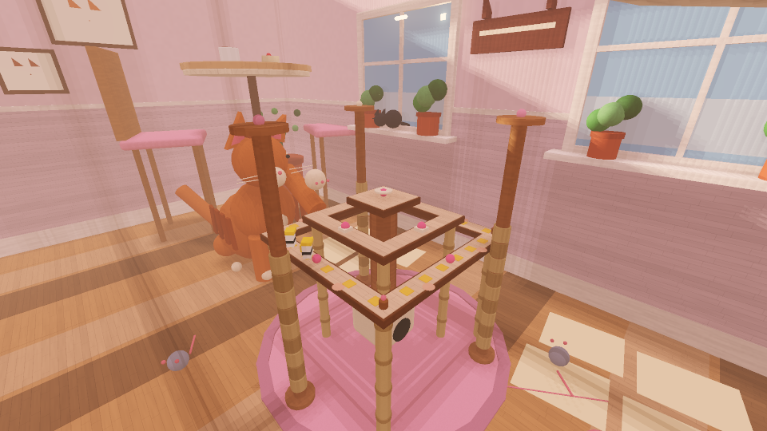 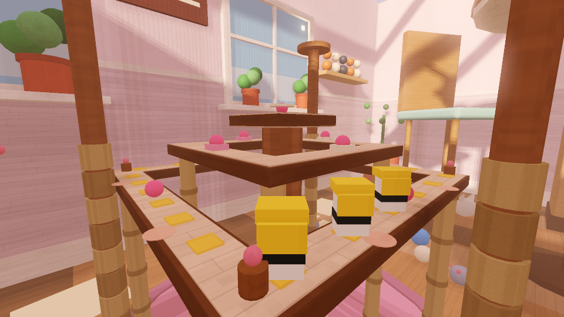</p>

#### 초대형 밥솥
`rice-cooker` · 계단식 밥 언덕
> 끓어오르는 밥알과 뜨거운 증기를 피해 밥 위에서 버텨요!

- **밥알 끓어오름**: 7초 주기로 위로 튕겨 올려요.
- **증기 띠**: 12초 주기로 순간 분사.
- 바닥은 안 사라지고, 밥솥 남은 시간 타이머가 보여요.

<p>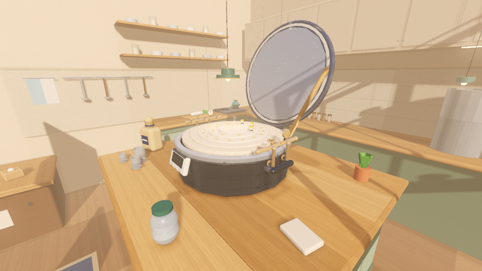 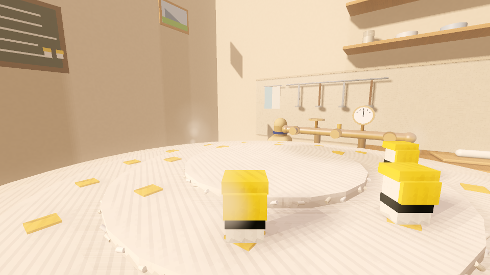</p>

#### 수산시장
`fish-market` · 얼음물 위 상자들
> 떨어지는 생선과 밀려오는 얼음을 피해 상자 위에서 버텨요!

- **생선 낙하**: ⚠ 경고 뒤 떨어져 누워서 팔딱거려요(8초 주기).
- **얼음 블록**: 10초마다 한 줄을 쓸고 지나가며 사람을 옮겨요(미끄러운 바닥은 아님).

<p>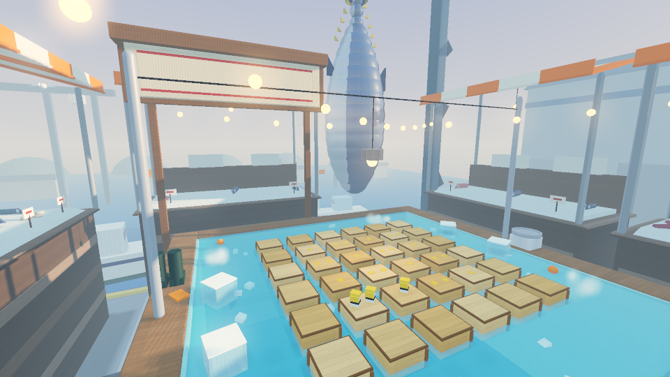 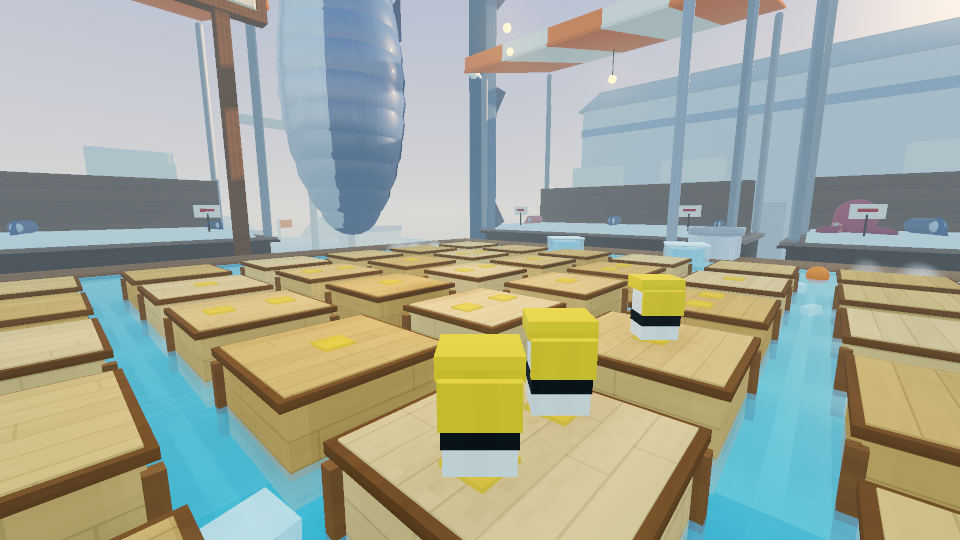</p>

---

### 🛡 대형 Survival — 스폰 40 · 12~40명

#### 중식당 회전 원판
`lazy-susan` · 붉은 등이 걸린 저녁 중식당 · 반지름 72
> 빙글빙글 도는 원판의 구멍을 피해 끝까지 버텨요! 빨간 칸은 곧 사라져요.

- 가운데 유리판 + **고리 4개가 번갈아 반대로** 돌아요. 고리 위에 서 있으면 도는 방향으로 밀려요.
- **구멍이 고리를 따라 움직여요**: 열리기 0.8초 전에 빨갛게 예고. 4초에 첫 구멍, 20초에 구멍이 늘어요.
- 고리 위 반찬 그릇에 닿으면 넘어져요(점프로 넘기).
- 45초 회전 1.4배 → 60초 서든데스: 구멍이 넓어지고 가운데 유리판도 5초마다 깜빡 열려요.

<p>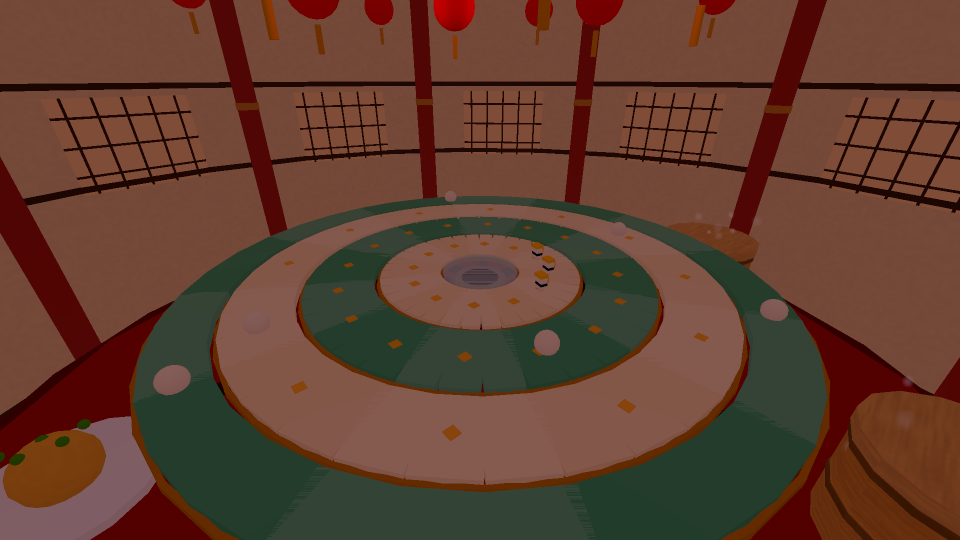 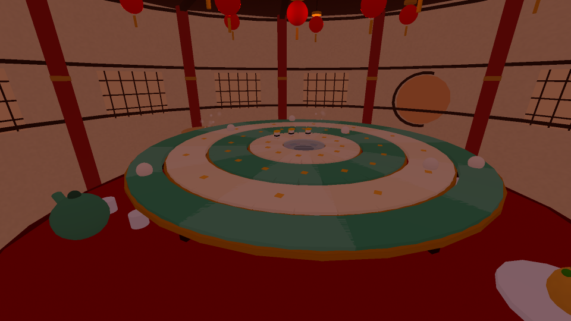</p>

#### 연회상 쟁반 쓸기
`banquet-sweep` · 종이 등이 켜진 저녁 연회장 · 96 × 96 다다미
> 밀려오는 쟁반 벽! 낮으면 뛰어넘고, 높으면 초록 빈칸으로 피해요!

- 쟁반 벽이 상 한 변 전체를 덮고 반대편까지 밀고 가요. 피하지 못하면 상 밖으로 밀려 떨어져요.
  - **남색 낮은 벽**(높이 3): 점프로 넘어요.
  - **붉은 높은 벽**(높이 14): 빈 칸 1~2개로만 지나가요.
- 벽이 오기 1.5초 전 그 변에 **노랑(벽) · 초록(빈 칸)** 예고 줄.
- 30초부터 서로 수직인 두 장이 동시에 → 45초에 바깥 한 줄이 무너져 72 × 72 → 60초 서든데스(빈 칸 1개).
- 판마다 벽 순서가 달라요.

<p>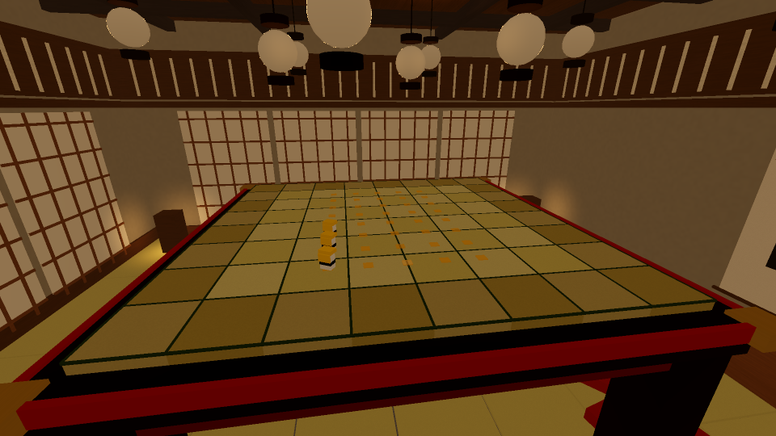 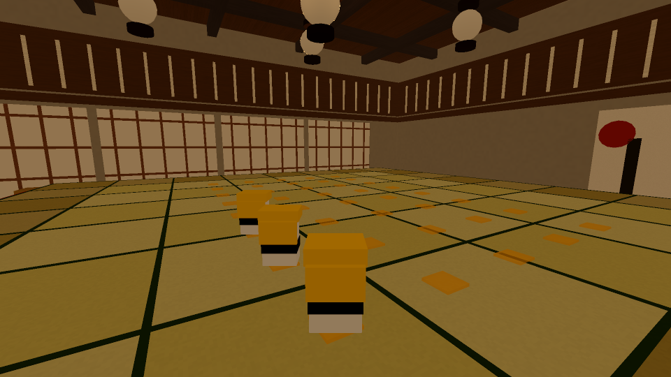</p>

---

### 🏆 Final — 마지막 1명 (90초 + 연장전)

#### 회전 꼬치 쇼다운
`skewer-showdown` · 해질녘 가게 문 앞 접시 무대
> 돌아오는 꼬치를 뛰어넘고 끝까지 버티세요! 마지막 1명만 탈출해요

- 거대한 꼬치 두 개가 돌아요: 낮은 꼬치는 점프로 넘고, 높은 꼬치(10초부터)는 너무 높이 뛰면 맞아요.
- 20초부터 셰프의 거대한 손이 접시 조각을 하나씩 집어 가요.
- 연장전: 꼬치가 더 빨라지고 바깥 줄부터 조각이 사라져요.

<p>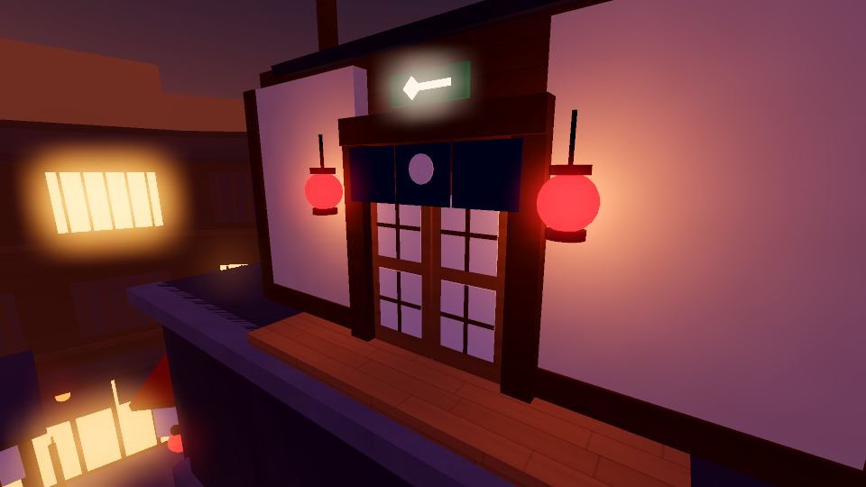 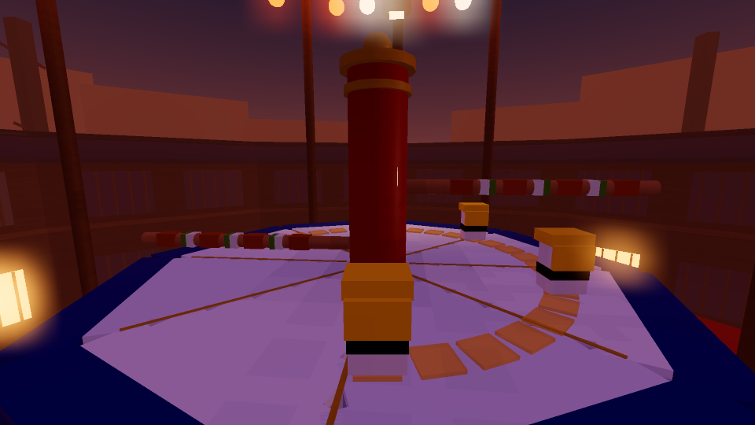</p>

#### 연어알 폭탄 접시
`ikura-bombs` · 해 질 녘 바닷가 둥근 접시(칸 17개)
> 떨어지는 연어알 폭탄을 피해 마지막까지 버텨요!

- 셰프 숟가락이 빨간 원(흰 테두리) 위로 와서 1.5초 뒤 연어알 폭탄이 터져 넉백(사람을 자주 노려요).
- 바깥 칸은 두 번 맞으면 떨어지고, 40초부터 바깥 → 60초부터 가운데 고리 칸이 떨어져요.
- 연장전: 바깥 고리 → 가운데 고리 → 원판 순서로 사라져요.

<p>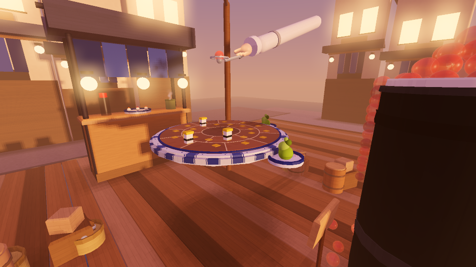 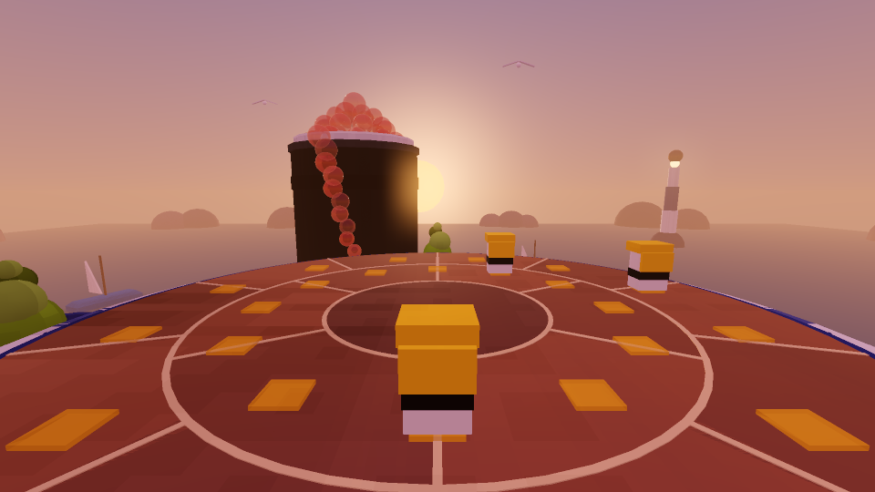</p>

#### 줄다리기 발판
`tug-of-war-platform` · 70 × 22 시소
> 사람들이 몰린 쪽으로 발판이 기울어요. 균형을 잘 잡고 끝까지 버티세요!

- 사람이 몰린 쪽으로 최대 30°까지 천천히 기울어요(미끄러운 재질).
- 연장전: 좌우로 점점 크게 흔들리다 20초에 수직이 돼요.

<p>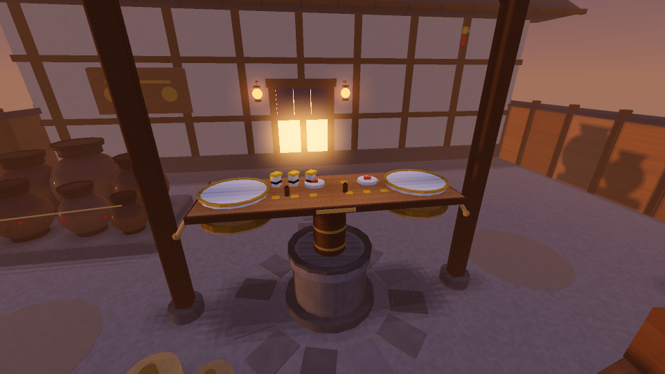 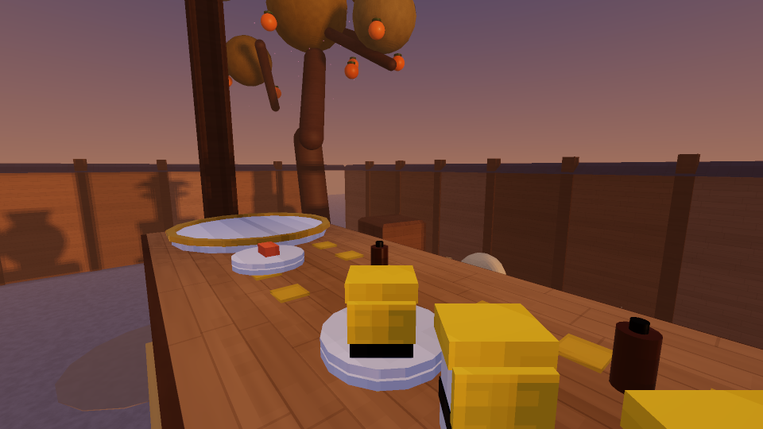</p>

#### 인형뽑기 기계 속
`claw-machine-prize` · 네온 오락실 유리 상자, 8 × 8 칸
> 집게가 훑고 지나가는 유리 상자 안에서 버텨요.

- 노란 경고 2초 뒤 집게가 2×2 칸(60초부터 3×3)을 들어 올려 없애요(사람을 자주 노림).
- 연장전: 상자가 기울며 낮아지는 쪽 줄부터 칸이 사라져요.

<p> </p>

#### 찻잎 정원
`tea-garden` · 벚꽃 차밭의 계단식 단
> 굴러오는 찻잔을 피해 단을 옮기고, 무너지는 차밭에서 끝까지 버텨요!

- 찻잔이 한 단을 돌다 6초마다 다른 단으로 옮겨 가요 — 단을 옮겨 피해요.
- 15초마다 바깥 단부터 무너져요.

<p> </p>

#### 온천탕 인형뽑기
`onsen-claw` · 밤 온천의 원형 데크
> 인형뽑기가 쿵! 퍼지는 충격파는 점프로 넘고, 차오르는 온천물을 피해요!

- 집게가 쿵 내려찍으면 **충격파 고리**가 퍼져요 — 점프로 넘어요(12초 주기).
- 온천물이 차올라 낮은 데크부터 가라앉아요(10초 주기).
- 연장전: 남은 데크가 낮은 단부터 하나씩 사라져요.

<p> </p>

---

## 7. 기술 메모

- Roblox Studio + Rojo, Luau(`--!strict`). 맵 판정·장식은 전부 코드로 만들어요(`src/shared/maps/<Map>{,Layout,Logic,Art}.luau`).
- 판정은 서버, 연출·UI는 클라이언트. 순수 로직은 Roblox API 없이 분리해 `tests/`(Lune)로 검사해요.
- 맵 캡처 다시 찍기: `lune run tools/render-map <mapId> --view all --quality high` → `build/renders/<mapId>/`. 캐릭터는 `lune run tools/render-character <skinId|all>`. 고른 컷은 `docs/renders/<mapId>/after-*.png`에 커밋해요.
- 위쪽 맵 시트(`docs/overview/maps-all.jpg`)는 맵마다 `after-*intro-01`(없으면 `after-intro`) 컷을 모아 만든 이미지예요. 맵을 추가하거나 캡처를 바꾸면 다시 만들어요.
- 개발 규칙·구조는 [`../CLAUDE.md`](../CLAUDE.md), 작업 흐름은 [`WORKFLOW.md`](WORKFLOW.md).
