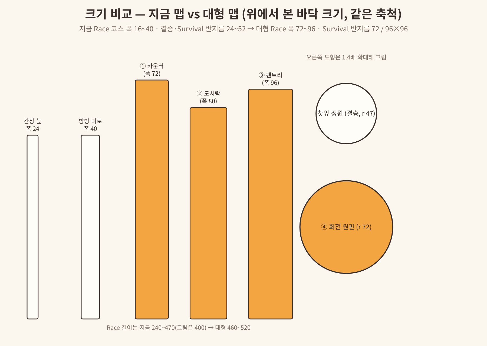

# REFERENCE — 대형 맵 · 많은 인원 (25~40명) 사례 조사

> **스시 파이트로 복사한 사본** (2026-11-11, 브랜치 `sushi-fight`, 원본 `docs/REFERENCE-large-maps.md` @ `a85fd669`). 원본은 스시런 문서로 그대로 둬요. 파이트에 어떻게 쓰는지는 [`README.md`](README.md). 링크는 원본 위치 기준으로 고쳐 두었어요.

- 작성: 메인 세션, **2026-11-08** (모든 출처 확인 날짜 = 2026-11-08)
- 목적: 사용자 요청 "좀 큰 맵도 만들어 보자. 더 넓고 많은 플레이어를 수용할 수 있는 맵들 기획" (2026-11-08)을 제안서 [`docs/proposals/large-maps.md`](../../proposals/large-maps.md)로 옮길 때 **인원·크기·구조**를 감이 아니라 사례로 정하기 위한 근거.
- 표기: **[원문]** = WebFetch로 원문 확인, **[검색]** = 검색 결과 목록만 확인, **추정** = 우리 계산.
- 이 문서는 참고 자료다. 결정은 제안서 "결정 필요"와 이후 스펙 "결정 기록"에 남긴다.

---

## 0. 이미지에 대해

- **레퍼런스 게임 화면은 이 문서에 넣지 못했다.** 작업 환경(클라우드 세션)의 네트워크가 위키·게임 사이트를 막아서 셸·브라우저 어느 쪽으로도 페이지를 열거나 캡처할 수 없었다(2026-11-08 확인: fandom.com·pcgamesn.com·wikimedia 모두 연결 실패). 아래 1절 링크로 원문을 볼 수 있다.
- 또 **이 저장소는 공개**라서, 다른 게임 스크린샷을 그대로 커밋하면 저작권 문제가 생길 수 있다. 화면 캡처를 문서에 꼭 넣고 싶다면 사용자가 직접 찍은 캡처를 **커밋하지 않는 폴더**(예: `docs/local-refs/`, `.gitignore`)에 두고 문서는 링크만 거는 방식을 권한다.
- 대신 **우리 맵 배치도(직접 그림)**를 제안서와 함께 [`docs/proposals/large-maps/`](../../proposals/large-maps/)에 넣었다(위에서 본 모습, 같은 축척 표시). 레퍼런스에서 가져온 구조가 우리 맵에서 어떻게 보이는지는 그 그림으로 확인한다.

## 1. 사례 표

| # | 게임 / 출처 | 쓸 곳 | 핵심 | 근거 수준 |
|---|---|---|---|---|
| A | **Fall Guys — 60명을 고른 이유** (PCGamesN 인터뷰) | 인원 상한 · 맵 크기 | 100명이면 "가장 단순한 레벨도 너무 붐벼서 덜 재밌고" 좁은 틈에 뭉쳐 막힘. 그래서 레벨을 키우면 "너무 크고 휑해서 하나로 안 느껴짐". **60명이 혼란과 감당 가능 사이의 균형**. 사람들은 실제 인원을 약 2배로 느낀다 | [원문] |
| B | **Fall Guys 업데이트 1.20** (2023-02-21) | 인원 상한 | Main Show 솔로 최대 인원 **60 → 40**. 이유: 매칭 속도, **라운드별 성능 최적화**, 40명 기준에서 쓸 수 있는 초반 라운드가 더 많아 다양성 ↑ | [원문] mp1st |
| C | **Fall Guys 라운드별 인원 범위** (Fandom Levels 표) | 맵마다 최소·최대 인원 | Door Dash·Big Fans(Race, 1라운드) **4~40**, Roll Out(Survival) **11~40**, Block Party(Survival) **9~30**, Hex-A-Gone(결승) **2~20**, Fall Mountain(결승) **2~9**. → 큰 맵은 "많을 때만", 결승은 "적을 때"용으로 따로 둔다 | [원문] |
| D | **Fall Guys — Fruit Chute** (Fandom) | 넓은 Race | 넓은 역방향 컨베이어 위를 오르는 코스, 가운데로 통나무, 양옆 튕김 장애물, 배경 대포가 과일을 무리로 쏨. **체크포인트 없음 — 떨어지면 출발점** | [원문] |
| E | **Fall Guys — Door Dash** | ② 도시락 뚜껑 대탈출 | 문 줄을 깨고 지나가는 Race, 일부는 가짜 문. 앞사람이 진짜 문을 찾아 주는 "군중이 길을 여는" 구조라 인원이 많을수록 재밌다 | [원문] Fandom Levels 표 |
| F | **Fall Guys — Roll Out** | ④ 회전 원판 | 서로 다른 방향으로 도는 고리 위에서 슬라임에 빠지지 않게 고리를 옮겨 다님(11~40명) | [원문] Fandom Levels 표 |
| G | **Fall Guys — Block Party** | ⑤ 연회상 쟁반 쓸기 | 판 위에서 밀려오는 벽을 피함, 떨어지면 탈락(9~30명). 기존 `REFERENCE-map-batch-3.md` B(수산시장 얼음 블록)에서도 참고 | [원문] Fandom Levels 표 |
| H | **Fall Guys — Big Fans** | ③ 팬트리 선반 대질주 | 큰 선풍기가 옆으로 밀어내는 Race(4~40명) | [원문] Fandom Levels 표 |
| I | **Stumble Guys 인원** (공식 FAQ) | 인원 상한 | 클래식 **최대 24명**, 랭크 12명, 이벤트 일부 32명, 커스텀 파티 **2~32명**(맵·설정에 따라) | [원문] |
| J | **Roblox 서버 크기** (DevForum 공지 2023-04-13) | 플레이스 설정 | 누구나 **200명 서버**까지 설정 가능(그 전엔 700명은 베타만). "큰 서버에서는 성능 문제가 있을 수 있음". 100명 초과면 소셜 슬롯은 최대 20% | [원문] |
| K | Roblox **StreamingEnabled** (DevForum 스레드 여러 개) | 성능 | 큰 월드는 스트리밍으로 클라이언트 메모리를 줄이지만, 클라이언트 코드가 "파츠가 있다"고 가정하면 깨진다. 우리 프로젝트는 `StreamingEnabled = false`(default.project.json) — 대형 맵 몇 개 때문에 켜지 않는다(제안서 6절) | [검색] devforum t/504827, t/625977 |

### 읽은 것 (원문 확인)
- PCGamesN — "Fall Guys' battle royale will feature 60 players rather than 100 - here's why": https://www.pcgamesn.com/fall-guys/player-count
- mp1st — "Fall Guys Update 1.20 Jumps Out for Lobby Size Changes This February 21": https://mp1st.com/title-updates-and-patches/fall-guys-update-1-20-jumps-out-for-lobby-size-changes-this-february-21
- Fall Guys Wiki (Fandom) — Levels: https://fallguysultimateknockout.fandom.com/wiki/Levels
- Fall Guys Wiki (Fandom) — Fruit Chute: https://fallguysultimateknockout.fandom.com/wiki/Fruit_Chute
- Stumble Guys 고객센터 — How many players per match: https://stumbleguys.helpshift.com/hc/en/4-stumble-guys/faq/220-how-many-players-per-match/
- Roblox DevForum — Experience Join Improvements: Server Size, Join Queues and Social Slots Reservations: https://devforum.roblox.com/t/experience-join-improvements-server-size-join-queues-and-social-slots-reservations/2294621

### 검색만 (원문 미확인)
- Roblox DevForum — StreamingEnabled maximum distance or part count: https://devforum.roblox.com/t/streamingenabled-maximum-distance-or-part-count/504827
- Roblox DevForum — Is StreamingEnabled good? Best ways for optimization?: https://devforum.roblox.com/t/is-streamingenabled-good-best-ways-for-optimization/625977
- Roblox 공식 문서 Instance streaming(https://create.roblox.com/docs/workspace/streaming)은 이 세션 허용 목록 밖이라 못 열었다.

## 2. 교훈 → 우리 규칙

| 교훈 (출처) | 우리 대형 맵 규칙 (제안서 5절) |
|---|---|
| 인원을 늘리면 좁은 틈에서 뭉친다 (A) | 좁은 곳 최소 폭 **14**, 출발 뒤 첫 30% 구간은 **18 이상**. 한 줄 길 대신 **갈래 길 2~4개** |
| 맵만 키우면 휑하다 (A) | 길이는 지금과 비슷하게(460~520), **폭만 2~3배**. 구간 사이에 "합류 광장"을 둬 사람들이 다시 모이게 |
| 40명이 성능·다양성 균형점 (B) | 방 최대 인원 선택지에 **32·40** 추가를 권장(결정 Q1). 그 이상은 안 함 |
| 맵마다 인원 범위가 다르다 (C) | 맵 모듈에 `minPlayers`·`capacity` — 큰 맵은 **12명 이상일 때만**, 지금 맵은 **24명 이하일 때만** 뽑힘 |
| 결승은 적은 인원용 (C: Hex-A-Gone 2~20, Fall Mountain 2~9) | 큰 결승 맵은 만들지 않고, 라운드를 하나 더 둬 결승 인원을 **5명 안팎**으로 유지(결정 Q2) |
| 군중이 길을 여는 구조가 많을수록 재밌다 (E) | ② 도시락: 가짜 문 위치를 라운드마다 서버가 정하고 모두에게 같게 |
| 떨어지면 출발점 (D) | 이미 m6-01 Race 부활과 같다 — 큰 Race도 그대로 씀 |
| 서버 상한은 넉넉(200)하나 성능 경고 (J) | 우리 Match 플레이스 최대 인원 24 → **40**(사용자 설정, 결정 Q3). 파츠·물리 예산 "Large" 새로 둠 |

## 3. 지금 우리 맵 크기 (코드 확인, 2026-11-08 main `efdb13c`)

| 종류 | 대표 값 | 출처 |
|---|---|---|
| Race 코스 폭 | 16~40 (간장 늪 24, 방방 미로 40, 등불 다리 16, 우주 레일 30) | 각 `*Layout.luau` |
| Race 코스 길이 | 약 240~470 studs, 빠른 사람 45~55초 | CLAUDE.md (m5-40) |
| Survival·결승 바닥 | 반지름 24~52 (연어알 24, 밥솥 40, 찻잎 정원 47, 온천 52) | 각 `*Layout.luau` |
| 스폰 | 맵마다 **24개 고정**(테스트가 24를 고정) | `Config.luau` 주석, `tests/*-qa.spec.luau` |
| 방 최대 인원 | 4/8/12/16/**24**, 기본 12 | `Config.Room.MaxPlayerOptions` |
| 서버 최대 인원 | Lobby 40 / Match 24 (사용자 설정 예정) | `docs/USER-TODO.md` |
| 아트 예산 | Extended: 파츠 1500 · 파티클 16 · 조명 24 · 그림자 2 · 움직임 80 | `MapKitLogic.BUDGETS` |
| 스트리밍 | 꺼짐 | `default.project.json` |
