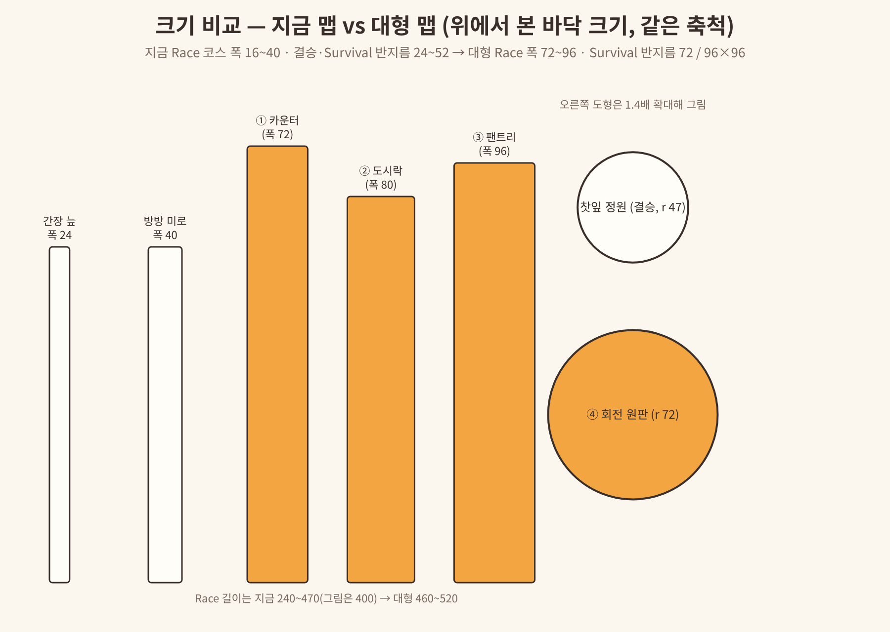
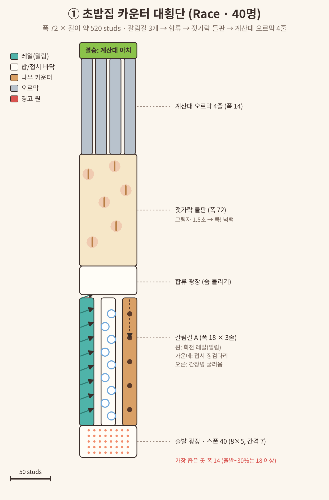
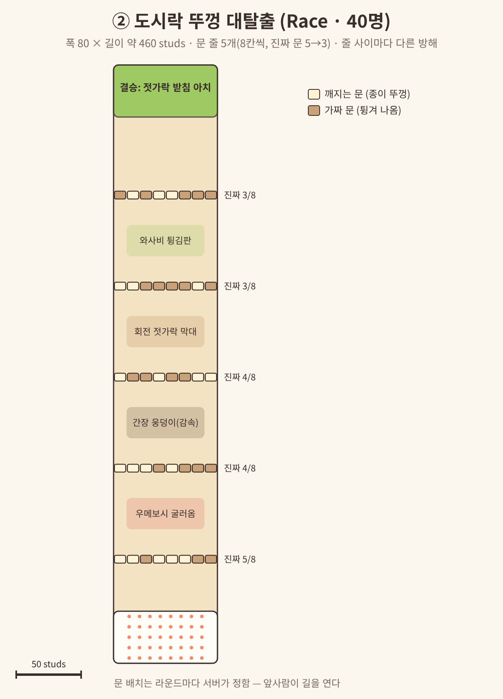
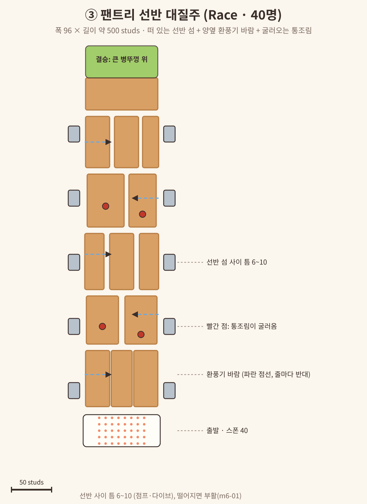
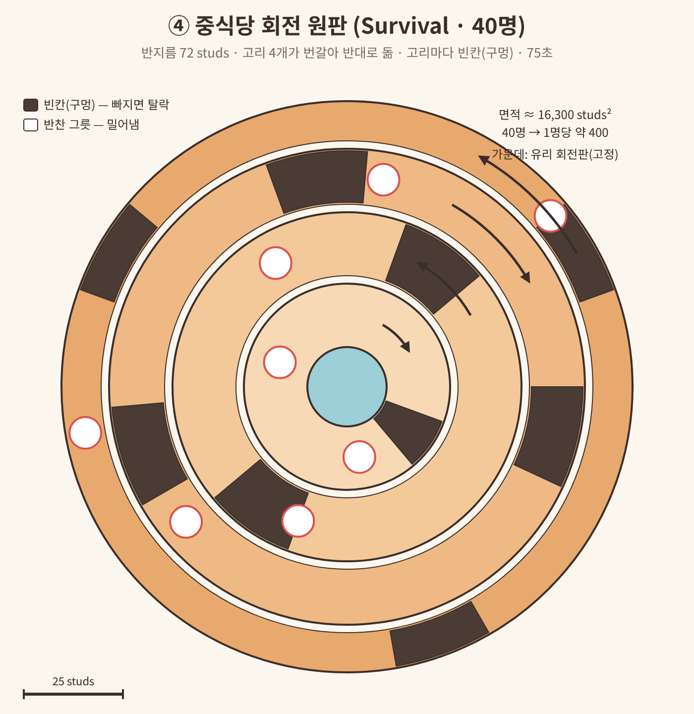
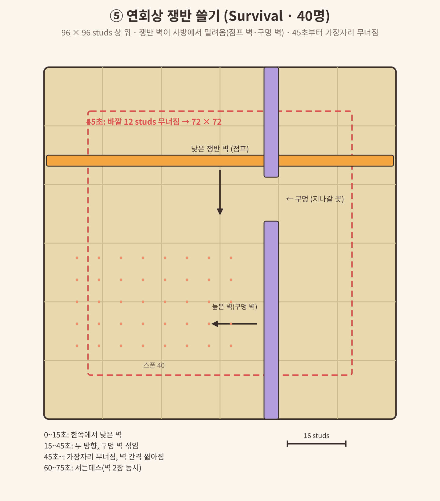

# 제안서 — 대형 맵 5개 + 방 인원 32·40명

- 작성: 메인 세션, **2026-11-08**
- 요청: 사용자 2026-11-08 "맵 개발 더 진행해. 좀 큰 맵도 만들어 보자. 더 넓고 많은 플레이어를 수용할 수 있는 맵들 기획해서 문서부터 작성해."
- 근거 자료: [`docs/REFERENCE-large-maps.md`](../REFERENCE-large-maps.md) (Fall Guys·Stumble Guys·Roblox 서버 크기 사례, 출처 확인 2026-11-08)
- 상태: **사용자 승인 전**(GDD 미반영). 7절 "결정 필요"에 답하면 planner가 GDD v0.9와 스펙(m6-02~)으로 옮긴다.
- 그림: 이 문서의 배치도는 전부 우리가 직접 그린 위에서 본 개념도다(`docs/proposals/large-maps/*.png`, 원본 `.svg`). 다시 그리려면 `python3 large_maps_diagrams.py <폴더>` → `node render_svgs.js <폴더>`(Playwright). 판정 수치의 최종값은 스펙에서 정한다.

---

## 0. 한 줄 요약

방 최대 인원에 **32·40명**을 더하고, 그 인원이 처음부터 한 맵에서 뛸 수 있는 **대형 맵 5개**(Race 3 · Survival 2)를 만든다. 대형 맵은 폭을 지금의 **2~3배(72~96 studs)**로 넓히되 길이는 비슷하게 두고, 길을 여러 갈래로 나눠 뭉침을 막는다. 24명 이하 방에서도 12명 이상이면 대형 맵이 나온다.

## 1. 레퍼런스에서 가져온 것 (자세한 건 REFERENCE 2절)

- **40명이 균형점.** Fall Guys는 100명이 "너무 붐벼 덜 재밌어서" 60명으로 시작했고, 2023년에 성능·매칭·다양성 때문에 **40명**으로 줄였다. Stumble Guys 커스텀 파티도 최대 **32명**. → 우리는 **32·40**까지만.
- **넓히되 길게 만들지 않는다.** 맵을 무작정 키우면 "너무 크고 휑하다"(Fall Guys 개발진). → 폭만 넓히고, 구간 사이 **합류 광장**으로 다시 모이게.
- **맵마다 인원 범위가 있다.** Fall Guys도 Door Dash·Big Fans는 4~40명, Roll Out 11~40명, 결승 Hex-A-Gone 2~20명처럼 나눈다. → 대형 맵은 "12명 이상일 때만", 지금 맵은 "24명 이하일 때만".
- **결승은 적은 인원용.** → 큰 결승 맵은 만들지 않고, 통과 비율을 조정해 결승 인원을 4명 안팎으로 유지.

## 2. 인원 · 라운드 구조 (권장안 A)

| 시작 인원 | 라운드 수 | 통과 비율 | 예시 (시작 → 1R 뒤 → 2R 뒤 → 결승) |
|---|---|---|---|
| 4~8 | 3 | 0.60 · 0.50 (지금 그대로) | 8 → 5 → 3 |
| 9~24 | 4 | 0.65 · 0.55 · 0.50 (지금 그대로) | 24 → 16 → 9 → 5 |
| **25~40 (새)** | **4** | **0.60 · 0.45 · 0.40** | 40 → **24** → 11 → **4** · 32 → 19 → 9 → 4 · 25 → 15 → 7 → 3 |

- 좋은 점: 라운드 수가 그대로라 **한 판 4~5분이 유지**되고, 40명 방도 **1라운드만 지나면 24명 이하**라 2라운드부터는 지금 맵 21개를 그대로 쓸 수 있다. 결승은 4명.
- 대안 B: 25~40명은 5라운드(0.65 · 0.55 · 0.55 · 0.50, 40 → 26 → 14 → 8 → 4). 라운드를 하나 더 하지만 한 판이 약 6~7분이 되고, 2라운드도 26명이라 대형 맵이 두 번 필요하다.
- 코드 영향: `Rules.roundCount`가 라운드 수만 보고 `Config.Rules.PassRatios[roundCount]`를 고르므로, **인원 구간별 비율**(`PassRatioTiers`)로 바꿔야 한다. 결승 2명 보장·바로 결승 규칙은 그대로.

## 3. 시스템 변경 (기반 스펙 m6-02에서 한 번에)

| 항목 | 지금 | 바꿀 것 |
|---|---|---|
| 방 최대 인원 | 4/8/12/16/24 | **4/8/12/16/24/32/40** (기본 12 그대로) |
| 맵 인원 범위 | 모든 맵 스폰 24개 고정 | 맵 모듈에 `capacity`(기본 24, 대형 40)·`minPlayers`(기본 없음, 대형 12). 스폰 수 = `capacity` |
| 판 계획 | 종류만 보고 맵 고름 | `Rules.buildRoundPlan`이 **그 라운드 예상 인원**이 `minPlayers ≤ n ≤ capacity`인 맵만 고름. 25명 이상 1라운드는 대형 Race만 |
| 텔레포트 | `PlacePayload.MAX_MEMBERS = 24` | 40 |
| 플레이스 최대 인원 | Match 24 / Lobby 40 (사용자 설정 예정) | Match **40**, Lobby는 Q3 |
| 아트 예산 | Standard / Extended | **Large** 새로: 파츠 2200 · 파티클 20 · 조명 32 · 그림자 2 · 움직임 120 (기본값, Studio 실측 뒤 조정) |
| 화면 | 24명 기준 | 결과 순위표·관전 대상 목록·방 대기실 참가자 목록이 40줄에서 스크롤되는지 확인(휴대폰 포함) |
| 스트리밍 | 꺼짐 | **그대로 꺼 둠**. 대형 맵 바닥 크기는 아레나 슬롯 간격(2000) 안이고, 켜면 클라이언트가 맵 파츠를 찾는 코드(조명·장식·카메라)가 깨질 수 있음 |

## 4. 대형 맵 5개

공통: 세계관 "작은 초밥, 거대한 주방"(아트 가이드), 1 stud ≈ 1 cm. 스폰 40개(8 × 5 격자, 간격 7~8). Race는 m6-01 부활 그대로(떨어지면 3초 뒤 출발점). 수치는 전부 **기본값**.

### ① 초밥집 카운터 대횡단 (`sushi-counter-crossing`, Race, 12~40명)

- 크기: 폭 72 × 길이 약 520. 빠른 사람 목표 **50~60초**(걷기 16 기준 순수 이동 약 33초 + 장애물).
- 흐름: 출발 광장 → **갈림길 A**(폭 18 × 3줄, 고르는 재미) → 합류 광장 → **젓가락 들판**(폭 72 전체) → **계산대 오르막 4줄**(폭 14) → 결승 계산대 아치.
  - 왼쪽 줄: 회전 레일 — 앞뒤로 밀림이 바뀜(우주 레일보다 느리고 단순).
  - 가운데 줄: 접시 징검다리 — 지름 10 접시, 틈 4~6 점프.
  - 오른쪽 줄: 간장병이 굴러옴 — 3초 간격, 맞으면 넉백.
  - 젓가락 들판: 빨간 그림자 원(지름 14) 1.5초 뒤 젓가락이 쿡 — 넉백(떨어지진 않음, 들판 가장자리는 벽).
- 차별화: 지금 Race는 한 줄 길 위주 → **처음으로 "길을 고르는" Race**. 젓가락 들판은 우주 레일 운석(원 경고 → 낙하)과 같은 읽기지만 바닥이 넓고 떨어질 곳이 없어 초보도 버팀.

### ② 도시락 뚜껑 대탈출 (`bento-door-dash`, Race, 12~40명)

- 크기: 폭 80 × 길이 약 460. 목표 50~60초.
- 흐름: 도시락 칸막이 벽이 **5줄**, 줄마다 종이 뚜껑 문 **8칸**(폭 10). 진짜(깨지는) 문 수 5 → 4 → 4 → 3 → 3. 가짜 문은 몸으로 부딪히면 튕겨 나옴.
- 줄 사이 방해(앞에서부터): 우메보시 굴러옴 → 간장 웅덩이(감속) → 회전 젓가락 막대(점프) → 와사비 튕김판.
- 진짜 문 위치는 **라운드마다 서버가 정하고 모두 같다**. 먼저 뚫은 사람이 길을 알려 주는 구조 — 인원이 많을수록 재밌다(Door Dash, REFERENCE E). 깨진 문은 그 라운드 내내 열려 있음.
- 주의: 문이 깨지는 판정은 서버(첫 접촉), 깨지는 연출은 클라이언트. 다이브로 깨기 가능.

### ③ 팬트리 선반 대질주 (`pantry-shelf-dash`, Race, 12~40명)

- 크기: 폭 96 × 길이 약 500. 목표 50~60초.
- 흐름: 공중에 뜬 **나무 선반 섬**이 5줄(줄마다 2~3개, 틈 6~10 — 점프·다이브). 양옆 벽의 **환풍기**가 줄마다 반대 방향으로 옆바람(약 4초 켜짐 / 2초 꺼짐), 바람 전에 날개가 빨라지는 예고. 경사진 선반에서 **통조림이 굴러옴**. 결승은 큰 병뚜껑 위.
- 차별화: 지금 Race 중 "옆으로 미는 바람"은 없음(Big Fans, REFERENCE H). 바람은 연속 밀기라 `MoveExempt`는 달지 않음(CLAUDE.md 규칙).

### ④ 중식당 회전 원판 (`lazy-susan`, Survival, 12~40명)

- 크기: 반지름 72(면적 약 16,300 studs², 40명이면 1명당 약 400. 지금 찻잎 정원 반지름 47의 약 2.3배).
- 흐름: 가운데 고정 유리판 + **고리 4개**가 번갈아 반대 방향으로 돎(바깥일수록 조금 빠름). 고리마다 **빈칸(구멍)** 1~3개 — 빠지면 탈락. 고리 위 **반찬 그릇**이 같이 돌며 사람을 밀어냄. 고리를 옮겨 다니며 빈칸을 피한다(Roll Out, REFERENCE F).
- 진행: 0~20초 빈칸 1개씩 → 20~45초 고리마다 빈칸 +1 → 45초 회전 빨라짐 → 60~75초 서든데스(가운데 유리판도 기울기 시작). 75초 버티면 전원 통과(Survival 규칙 그대로).
- 차별화: 찻잎 정원(결승)은 "단이 무너지고 찻잔을 피함", 이건 "도는 고리 사이를 옮겨 다님". 회전 위 이동은 연속 밀기라 `MoveExempt` 없음.

### ⑤ 연회상 쟁반 쓸기 (`banquet-sweep`, Survival, 12~40명)

- 크기: 96 × 96 다다미 상 위. 45초에 바깥 12 studs가 무너져 72 × 72.
- 흐름: 상 가장자리에서 **쟁반 벽**이 반대편까지 밀고 지나감. 벽 종류: 낮은 벽(점프로 넘음) / 높은 벽 + 구멍 1~2칸(구멍으로 피함). 벽 오기 1.5초 전 그 변에 노란 줄 예고.
- 진행: 0~15초 한 방향 낮은 벽 → 15~45초 두 방향, 구멍 벽 섞임 → 45초 가장자리 무너짐, 벽 간격 짧아짐 → 60~75초 서든데스(벽 두 장 동시).
- 차별화: 수산시장 얼음 블록(줄을 따라 오는 블록 몇 개)과 달리 **변 전체를 쓰는 벽**이라 40명이 한꺼번에 반응해야 함(Block Party, REFERENCE G). 벽에 밀리는 건 서버 넉백 → `MoveExempt.mark`.

## 5. 대형 맵 설계 규칙 (스펙·QA가 확인할 숫자)

1. **폭**: Race 코스 전체 폭 72~96. 좁은 곳 최소 폭 **14**, 출발 뒤 첫 30% 구간은 **18 이상**(40명이 한꺼번에 출발).
2. **갈래**: Race는 한 구간 이상에서 **2~4갈래** 길. 갈래 사이 난이도 차이는 "빠르지만 위험 / 느리지만 안전".
3. **합류**: 갈래 뒤나 긴 구간 사이에 **합류 광장**(전체 폭 × 30~40 깊이) — 휑하지 않게, 경쟁이 다시 보이게.
4. **길이**: Race 460~520, 빠른 사람 50~60초(지금 45~55초보다 조금 김 — 1라운드 인원이 많아 정원 차는 시간이 비슷). 맵별 `Logic.estimateClearTime`.
5. **스폰**: 40개, 8 × 5 격자, 간격 7~8, 전부 판정 바닥 위(지금 테스트 규칙과 같음).
6. **떨어질 곳**: Race는 부활이 있으니 떨어지는 구간을 둬도 되지만, 출발 첫 30%에는 떨어질 곳을 두지 않음(40명 뭉친 상태에서 억울한 낙하 방지).
7. **장애물 개수**: 서버 물리(풀린 파츠) 대신 앵커 + 트윈/CFrame으로 움직임. 한 맵에서 동시에 움직이는 판정 파츠 **60개 이하**(기본값).
8. **가독성**: 40명이 섞여도 장애물 예고(빨간 원·노란 줄·빨라지는 날개)가 캐릭터에 가리지 않게 바닥에서 0.2 위, 지름·두께를 지금 맵보다 1.5배.
9. **아트**: Large 예산, 아트 가이드 체크리스트 18개, 렌더 → 비평 → 고침 3회. 넓은 바닥이 단조롭지 않게 바닥 무늬·소품 섬.

## 6. 성능 메모

- Fall Guys도 40명으로 줄인 이유 중 하나가 라운드별 성능이었다(REFERENCE B). 우리도 40명 + 대형 맵에서 **휴대폰 프레임**을 Studio Device 에뮬레이터 + 실제 기기로 확인한다.
- 한 플레이스 모드(Studio·분리 전)에서는 한 서버에 방 여러 개 + 아레나 여러 개가 같이 돈다. 40명 방이 생기면 그 서버의 다른 방은 거의 못 생김 → 분리 모드(Match 플레이스) 권장.
- 스트리밍은 켜지 않는다(3절). 대형 맵 장식이 무거우면 먼저 Large 예산 안에서 줄인다.

## 7. 결정 필요 (사용자)

| # | 질문 | 권장 | 다른 선택 |
|---|---|---|---|
| Q1 | 방 최대 인원 선택지 | **32·40 추가** (4/8/12/16/24/32/40) | 32까지만 / 40만 추가 |
| Q2 | 25~40명 판 구조 | **A: 4라운드, 통과 0.60·0.45·0.40** (40 → 24 → 11 → 4, 한 판 4~5분) | B: 5라운드 (한 판 약 6~7분) |
| Q3 | 플레이스 최대 인원 | **Match 40**, Lobby 40 → **50** (한 플레이스 모드에서 40명 방 + 다른 사람 여유) | Lobby 40 유지 |
| Q4 | 만들 맵 | **5개 전부** (Race 3 · Survival 2) | Race 3개 먼저(25명 이상 판은 1라운드만 대형 맵이 꼭 필요) |
| Q5 | 24명 이하 방에서도 대형 맵 | **나옴** (그 라운드 12명 이상일 때) | 25명 이상 방에서만 |

## 8. 다음 절차 (승인 뒤)

1. planner: GDD v0.9(3·4·5·11절), 스펙 **m6-02 대형 맵 기반**(인원 선택지·`capacity`/`minPlayers`·판 계획·통과 비율 구간·Large 예산·`PlacePayload` 40·UI 40줄) — 공용 파일(`Config`·`maps/init`·`MapTypes`)은 이 스펙만 수정.
2. 스펙 **m6-03~m6-07** 맵 5개(맵마다 worktree, 아트 패스 포함, `docs/renders/<mapId>/before-*`·`after-*.png`).
3. developer → qa → docs-writer (WORKFLOW). Studio에서는 Clients and Servers 여러 명으로 출발 뭉침·장애물 판정을 보고, 40명 실제 혼잡·휴대폰 프레임은 비공개 테스트에서 확인.
